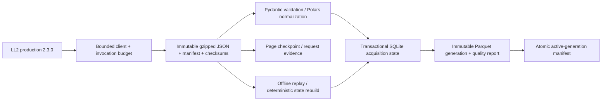

# Architecture

Phases 0–2 run locally. All state stays under the configured data directory (`data/` by default). No service, schedule, warehouse or public release is provisioned.

`pipeline.ingest` owns acquisition → durable raw → checkpoint → validation/normalization. Explicit plans in `windows.py` freeze query windows, passes, page size and policy. `run_plan` shares a request budget across components. Each accepted run is applied transactionally to SQLite; the plan's progress and complete-window cursor move with its accepted state. Separate content versions, sightings and observation events preserve A→B→A histories while semantic hashes ignore media and counters. Equal source-update timestamps with conflicting semantic content are retained as conflicts rather than silently chosen.

Raw response bodies preserve unknown JSON fields and metadata; images are not downloaded. Checksums cover decompressed response bytes. Request evidence records reservation, send and receipt times, status and non-secret query details. Retries count against a shared local rolling quota. Raw data remains filesystem-backed and replayable; `rebuild-state` reconstructs accepted live runs without network. Offline-import runs are excluded unless explicitly selected by run ID.

The SQLite database `state/launch_atlas.sqlite` is the current-state/acquisition system of record. It is not the analytical warehouse. Current launch records, launch attempts, semantic observations, per-window coverage and upcoming schedule intervals retain their declared grain. `fact_upcoming_schedule` uses source precision as a half-open interval `[start,end)` and includes only supported intervals overlapping the frozen refresh horizon. Unsupported precision remains in coverage. Launch counts are never multiplied through stages, payloads, families or schedule events.

`state-export` writes a new revisioned Parquet directory. It validates a candidate generation before changing `exports/active.json`; a failed candidate leaves the prior pointer intact. Exported files are derived and can be reconstructed from raw plus policy/versioned code. A completed refresh's frozen as-of timestamp is stored in SQLite and complete refresh manifests so offline rebuild reproduces the same horizon.

Source scope is explicit: orbital history/refresh queries use `include_suborbital=false`; bounded corrections broaden scope to catch reclassification and retain actual query provenance. Unknown orbital/mission scope remains visible and excluded from orbital attempt facts. A source query's count or a completed query window does not establish worldwide completeness.

Proposed production remains GCS → BigQuery → dbt → candidate validation → retained reporting release + active-release pointer → Google Data Studio. A future Dagster job will wrap ingestion/load/dbt/check/publication and scheduled GitHub Actions will invoke that dependency chain. Cloud adapter compatibility, warehouse SQL, identity, spend and rollback are unvalidated and gated on later decisions. No cloud access, cloud credential or publication is required for local Phase 2.

Limitations: offset pagination is mutable, so the two-pass comparison and bounded correction overlap reduce but cannot prove provider snapshot completeness. Current local quota/locks coordinate only processes sharing one data directory, not every consumer using the public IP. Historical acquisition remains incomplete; see `docs/phase2_verification.json` and `docs/handoff.md`.
