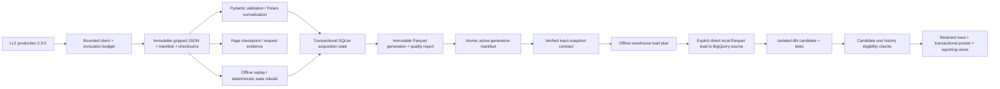
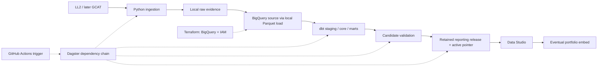

# Architecture

## Purpose and product scope

Space Launch Atlas uses publicly available data to explain worldwide launch activity through interactive visualizations: industry growth, providers and vehicles, outcomes, spaceports, reuse and upcoming schedules. The intended audience is curious visitors and analysts; technical reviewers can trace each metric to its source and grain. It also demonstrates a reproducible data engineering and analytics engineering workflow.

Release 1 focuses on orbital launches from 1957 onward, with the main comparisons from 2000 onward and a 90-day upcoming view. The user confirmed detailed satellite and spacecraft views for release 2; those views require measured payload/source linkage coverage. Orbit tracking and telemetry are outside the current product. [Metric contracts](docs/metrics.md) define what each chart can claim.

## Explicit technology stack

**Reporting decision, 2026-11-07, clarified 2026-11-08: the no-cost edition of Data Studio (formerly Looker Studio) is selected.** Data Studio consumes validated BigQuery reporting tables/views; metric logic lives in dbt SQL. It hosts reports/data sources without provisioning a BI server instance. A personal Google account supports report authoring and owner/viewer data credentials; managed Workspace/Cloud Identity is required only for the optional Data Studio service-account credential mode. Account administration and the optional Pro subscription are separate choices. [Product](https://docs.cloud.google.com/data-studio/welcome), [credentials](https://docs.cloud.google.com/data-studio/data-credentials-article).

| Technology | Responsibility | Actual status |
|---|---|---|
| Launch Library 2 public API | Primary launch, vehicle, site, schedule and available hardware/landing records. | Initial 1957–2026 history backfill and raw replay audit complete. The resumed local worker advanced state to revision 217 on 2026-11-11 (7,683 launch records, zero conflicts); weekly acquisition is active. Source pagination remains mutable and does not prove worldwide completeness. |
| GCAT public datasets | Historical cross-check and identifier-linked satellite/payload enrichment. | Planned for release 2, with linkage/coverage review. |
| Python 3.12 | Installed CLI and pipeline execution. | Implemented locally. |
| uv + uv.lock | Environment, package installation and reproducible dependency versions. | Implemented locally. |
| httpx | Bounded HTTP acquisition, pagination, retries and quota handling. | Implemented locally. |
| Pydantic | Typed settings and source-response validation. | Implemented locally. |
| Polars | Normalization, grain-aware tables and local analytical exports. | Implemented locally. |
| Gzipped JSON + SHA-256 | Immutable raw source responses, integrity and replay evidence. | Implemented on local filesystem. |
| SQLite (standard library) | Transactional local current state, sightings/events, conflicts and acquisition progress. | Implemented locally; cross-machine deployment of this state remains to be designed. |
| Apache Parquet | Typed, portable per-run and revisioned current-state export files. | Implemented locally. |
| Terraform + HashiCorp Google provider | Define six BigQuery datasets, required APIs, workload service accounts and least-privilege IAM. | CLI 1.13.1/provider 7.46.2; applied to the existing project on 2026-11-08. A follow-up refresh plan reported no drift. Local state only; no GCS. |
| Google Cloud Storage (GCS) | Possible future shared raw archive. | Deferred to keep raw files local and avoid storage costs. No bucket/API/IAM is defined or deployed. |
| BigQuery | Warehouse source, staging, core, marts, reporting and scratch datasets. | Six datasets exist. Current production release `sla-release-v1-d4f4ae640e0934f11d7ad4c4` was published on 2026-11-11 from snapshot `sla-input-v1-36d5e54dfe66915cc6747fa6ad17f1ad1d3726b57b1cc8d4d664627d7e3e271b`. It contains 6,903 orbital attempts and 179 upcoming rows; the private report now uses production reporting relations. |
| dbt Core + dbt-bigquery | SQL transformations, metric marts, documentation and warehouse quality tests. | The production run built 31 models and passed 108 dbt tests. The integrated runner caps each query at 100 MB; the standalone profile defaults to an environment-configurable 1 GB cap. |
| Google Cloud CLI + Google user ADC | Interactive local authentication for dbt, Google client libraries and Terraform. | Google Cloud CLI 593.0.0 is installed per-user. ADC was created on 2026-11-11 under `%APPDATA%\gcloud\application_default_credentials.json` with the `cloud-platform` scope; Cloud SQL was not requested. OAuth scope, IAM and user-authorized service use are separate limits. The Desktop OAuth client in Testing is inactive. This is not the unattended runner identity. |
| Dagster + dagster-dbt | Execute the ingest, load, SQL, validation and release dependency chain. | The six-op Dagster job executes in process; dbt runs in an isolated CLI subprocess with retained artifacts. dagster-dbt is installed/locked but is not invoked by this job. The earlier Windows stall was sandbox-blocked asyncio loopback, verified by a stack trace and successful execution outside that sandbox. A local Windows task invokes the guarded warehouse wrapper daily; no cloud scheduler is configured. |
| GitHub Actions | CI, then the future scheduled trigger for the Dagster job. | Locked warehouse dependencies are installed for type checks and offline tests on Linux and Windows; both platforms verified. No data-refresh schedule or cloud credentials in CI. |
| Windows Task Scheduler + local Python worker | Resume the finite LL2 history plan, perform a catch-up, audit replay, then run weekly source deltas. | Initial backfill, catch-up and raw replay audit completed. The task was reported Ready at the 2026-11-11 catch-up, which advanced state to revision 217 with zero conflicts; the next refresh is due 2026-11-18. Current task registration could not be re-read from this restricted shell. This worker only calls LL2 and updates local state/Parquet; it does not run BigQuery jobs. |
| Data Studio (formerly Looker Studio), no-cost edition | Interactive charts, filters, maps, methodology/freshness and eventual portfolio embedding. | No server instance required. On 2026-11-11 the private five-page report's six embedded sources were rebound to production and showed Functional. Manual refresh displayed current release `sla-release-v1-d4f4ae640e0934f11d7ad4c4`, 7,683 source records, 6,903 orbital attempts and current coverage counts. The personal owner/query identity uses its existing project-owner IAM under the user's scoped exception to the read-only rule. No IAM change, sharing, publication or recurring Data Studio refresh was made. The old scratch preview expires 2026-11-16 but is no longer referenced by the report. |
| pytest, Ruff, Pyright | Python behavior tests, lint/format and type checks. | Run locally; default pytest tests are offline. |
| Terraform fmt / validate / native mock tests | Infrastructure syntax/schema and resource-policy checks without a GCP account. | Run locally; mocks do not prove deployability or cloud IAM. |
| Git + GitHub | Version control for code, contracts, infrastructure and evidence summaries. | Public [RM3006/orbital-pulse](https://github.com/RM3006/orbital-pulse), default branch main. Credentials, raw/state, Terraform state and generated artifacts remain ignored. |

## Implemented local dependency chain

Steps 0–3 have a local implementation; the initial history backfill, replay audit and first full-history production warehouse release are complete. The production run used the revision-214 input snapshot; its release manifest is `data/warehouse/runs/e71d2078ba98455c9b16bfbaef16d3c8/release-manifest.json` (ignored). The reporting contract has nine analytical marts and six dimension or bridge relations. Readers select retained rows through a transactional active pointer. When a baseline exists, the candidate checks all 15 relation counts against the active manifest in that namespace. Changes beyond the tolerance of 10% or five rows, whichever is larger, block publication. Terraform manages six datasets, four APIs and scoped identities. Raw data and state remain local under `data/`.

`pipeline.ingest` owns acquisition → durable raw → checkpoint → validation/normalization. Explicit plans in `windows.py` freeze query windows, passes, page size and policy. `run_plan` shares a request budget across components. Each accepted run is applied transactionally to SQLite; the plan's progress and complete-window cursor move with its accepted state. Separate content versions, sightings and observation events preserve A→B→A histories while semantic hashes ignore media and counters. Equal source-update timestamps with conflicting semantic content are retained as conflicts rather than silently chosen.

Raw response bodies preserve unknown JSON fields and metadata; images are not downloaded. Checksums cover decompressed response bytes. Request evidence records reservation, send and receipt times, status and non-secret query details. Retries count against a shared local rolling quota. Raw data remains filesystem-backed and replayable; `rebuild-state` reconstructs accepted live runs without network. Offline-import runs are excluded unless explicitly selected by run ID.

The SQLite database `state/launch_atlas.sqlite` is the current-state/acquisition system of record. It is not the analytical warehouse. Current launch records, launch attempts, semantic observations, per-window coverage and upcoming schedule intervals retain their declared grain. `fact_upcoming_schedule` uses source precision as a half-open interval `[start,end)` and includes only supported intervals overlapping the frozen refresh horizon. Unsupported precision remains in coverage. Launch counts are never multiplied through stages, payloads, families or schedule events.

`state-export` writes a new revisioned Parquet directory. It validates a candidate generation before changing `exports/active.json`; a failed candidate leaves the prior pointer intact. Exported files are derived and can be reconstructed from raw plus policy/versioned code. A completed refresh's frozen as-of timestamp is stored in SQLite and complete refresh manifests so offline rebuild reproduces the same horizon.

`input-snapshot` is an offline Step 3 boundary. It requires the active Parquet generation to match the current SQLite revision and its passing quality report, checks every Parquet checksum/row count, and verifies each accepted source run's manifest and raw page metadata/checksums. The immutable v1 snapshot records source windows and reconciliation, coverage/plans, frozen as-of, parser/hash/event-key versions and a digest of transformation inputs. Its content-derived ID excludes incidental export-generation IDs and creation timestamps; semantically relevant coverage/as-of and file checksums remain part of the identity. This pins inputs locally; it does not upload or load them into GCP.

`warehouse-prepare` verifies the pinned inputs, adds the snapshot key to explicit-schema Parquet copies and writes a deterministic plan. `warehouse-load` rechecks local raw/Parquet checksums, uses explicit file-load schemas and deterministic job IDs, waits for completion, verifies counts and writes a receipt. No raw/GCS upload occurs. Load contract v3 adds an explicit source-dataset override for expiring scratch tests; production defaults stay the same. Prepared paths use a 24-hex directory plus a checked full snapshot identity to avoid Windows path-length failures and reject prefix collisions.

The `models/` project declares snapshot-filtered staging/core/marts with grain/volume checks and nonempty unit examples. Each pipeline invocation uses unique candidate aliases in scratch, preventing concurrent builds from overwriting each other's relations. The runner checks the transformation-code digest before and after dbt, validates matching artifact invocation IDs and successful execution of every enabled model/test, then binds the expected reporting relations to that invocation. The early revision-42 baseline contained 1,744 attempts and 179 upcoming intervals; the full-history production release contains 6,903 launch-attempt rows, 7,713 schedule-movement rows and 179 upcoming intervals as of 2026-11-09T19:31:28Z. Metrics and exclusions live in [docs/metrics.md](docs/metrics.md).

The first release has no prior row-count baseline. Later candidates compare each retained reporting relation to the active manifest using a 10% tolerance with a five-row minimum. Exceeding that threshold records relation-level errors in candidate evidence and blocks activation; a legitimate data correction must be investigated before changing the tolerance or retrying.

`BigQueryReportingStore` extends the metadata backend with release-scoped retained rows, schema/row-count checks and a deterministic SHA-256 multiset digest of row hashes. It verifies the candidate before copying and verifies retained data before activation and rollback. Data is appended idempotently for a release; old rows are not rebuilt from mutable sources. Permanent table/view creation happens before the pointer transaction. Stable reader views reference retained rows, validated metadata and one active pointer, and expose analysis/publication/activation times. The gate rejects incomplete history before any production reporting retention begins. Corrupt manifest identities and changed/missing retained rows are rejected.

`warehouse-run` invokes acquisition (only if a refresh plan is explicitly supplied) → validated export/snapshot → verified load → dbt/tests/content checks → retention → compare-and-swap activation. Without `--publish` it builds and inspects a candidate only. Publishing requires an explicit expected active release; a stale writer cannot replace a newer release. Failures stop dependent operations and save a credential-free `failure.json`. The optional ingestion boundary refuses an incomplete refresh. CLI imports require no credentials; cloud clients are constructed only for explicit cloud commands.

The explicit `--publish --preview` path pins accepted local inputs under the worker lock and runs the same warehouse chain in scratch. It records a preview manifest and an independent `preview_active_release` pointer. The reporting views carry a preview marker and the coverage mart records incomplete history. Production and preview manifests are restricted to their respective release namespaces.

Source scope is explicit: orbital history/refresh queries use `include_suborbital=false`; bounded corrections broaden scope to catch reclassification and retain actual query provenance. Unknown orbital/mission scope remains visible and excluded from orbital attempt facts. A source query's count or a completed query window does not establish worldwide completeness.

## Selected production direction and deployment boundaries

`infra/terraform/` contains declarative resource configuration, a provider lockfile and mock tests. It requires an explicit existing project and BigQuery location; no GCS bucket, Storage API, or storage IAM is in the current configuration. Terraform defines six BigQuery datasets including expiring scratch, four APIs, separate ingest/transform identities and scoped dataset roles. The optional Data Studio service account remains disabled because service-account credentials require managed Workspace or Cloud Identity eligibility. Terraform owns resource containers/IAM; dbt owns analytical tables/views; the pipeline owns data and release metadata. It does not provision a Looker instance or a Data Studio report. The user authorized the bounded project changes on 2026-11-08; the plan was applied and the subsequent refresh plan was clean.

The Dagster dependency chain runs locally. The `OrbitalPulse-LL2` Windows task is intended to run five-minute/logon checks, making source requests only when the weekly refresh is due. The `OrbitalPulse-Warehouse` task checks daily at 15:00 local time and can invoke the warehouse chain only for a complete changed snapshot after checking configured-project query and table-size headroom and an explicit free-tier scope confirmation. Google applies its 1 TiB query and 10 GiB storage free allowances per billing account; project-only usage cannot establish account-wide headroom. The scope confirmation is currently unset, so scheduled production publication safely skips. Both tasks run as the signed-in Windows user and require this PC to be awake. Workload service accounts are not configured as unattended runners. A hosted scheduler needs durable SQLite, checkpoints, raw/quota state and a keyless identity before it can own this workflow. No cloud scheduler or compute resource was created. Offline tests permit local loopback only for explicitly marked asyncio tests and block external sockets. No credentials are needed for local Python, dbt parse or Terraform mock checks.

Warehouse publication selects one validated reporting release consistently across marts and retains earlier releases for rollback. Data Studio can cache chart queries independently, so a warehouse pointer change does not promise simultaneous chart refresh. On 2026-11-11, the private report's six sources were moved from scratch to production and manually refreshed; the coverage table displayed the current release ID and counts. The report remains private and has no scheduled refresh. Its report-specific query bytes have not been isolated from project-wide job usage.

Limitations: offset pagination is mutable. Two-pass comparison and bounded correction overlap reduce risk without proving a provider snapshot or worldwide completeness. Local locks/quota state coordinate processes sharing one data directory, not every public-IP consumer. The initial available history is acquired and reconciled, but completeness is limited to returned LL2 data and project query scope; see [evidence](docs/step2_verification.json) and [roadmap](ROADMAP.md).

BigQuery use was authorized within the monthly free usage limits. The 2026-11-11 preflight observed 29,066,526,720 billed query bytes across 3,108 project jobs and 147,906,785 stored bytes across 545 tables before the release run. The release then billed 681,574,400 bytes across 94 query jobs; all 139 enabled dbt models/tests passed. After publication and manual report refresh, a read-only metadata check observed 31,279,022,080 project query bytes across 3,366 completed query jobs and 179,064,050 stored bytes across 565 tables. These figures include all users/jobs in the configured project, are not report-specific and are not an invoice. Google's 1 TiB query and 10 GiB storage allowances apply per billing account. Usage in any other project on that account is unknown, so the project figures do not prove remaining free headroom. Automatic warehouse publication now requires `BIGQUERY_FREE_TIER_SCOPE=single-project-confirmed` in ignored `.env.local`, set only after confirming this is the only BigQuery project using the billing account; it is currently unset. The local scheduler also applies 20 GiB query and 1 GiB storage reserves to this project's observations, but that cannot cap Data Studio traffic or usage from another project. The private report uses the personal owner's existing project-owner IAM under the approved exception; no IAM change was made. The report remains private and no website is published; GCS is deferred. See [BigQuery pricing](https://cloud.google.com/bigquery/pricing), [sandbox limits](https://docs.cloud.google.com/bigquery/docs/sandbox) and [connector prerequisites](https://docs.cloud.google.com/data-studio/connect-to-google-bigquery).

Reporting research on 2026-11-08 confirmed an active Free Trial in the billing console; it did not establish an upgraded paid account. Private billing observations remain in ignored evidence. The current ADC could read BigQuery metadata but Cloud Billing metadata returned HTTP 403, so that response is not evidence of disabled billing. The production reporting dataset had no tables at that point. The recorded revision-42 run billed 1,468,006,400 query bytes for dbt and 157,286,400 bytes for candidate inspection: 1.514 GiB before publication/report overhead. A weekly 31-day extrapolation is about 6.7 GiB for that workload. These are estimates from one run, not invoices or forecasts for the completed history. As of 2026-11-08, the user had selected a weekly initial BigQuery refresh and a personal Google account as report owner, but no schedule or report/source had been created. Data Studio extracts remain a possible serving path, not yet selected or tested. They are static snapshots with 100 MB/750,000-row limits and would need metric, size, freshness and cross-source release-consistency tests before use. [Extract behavior/limits](https://docs.cloud.google.com/data-studio/extract-data-for-faster-performance). Local API ingestion can use a different cadence from warehouse builds. Details remain in ROADMAP.md and the ignored Step 3 verification JSON.

Step 5 identity and report check (2026-11-09): the personal account completed Data Studio setup, authorized its BigQuery connector and owns the private report. The user explicitly accepted the account's existing project `roles/owner` and scratch-dataset `OWNER` permissions for this report as a scoped exception to the read-only reporting rule; no IAM change was made. At that date the five pages queried six revision-95 scratch views and showed incomplete-history limitations. The coverage summary returned 4,341 orbital attempts, 230 unknown-scope records, zero unresolved attempt outcomes and 33 upcoming records with unsupported precision; the upcoming manifest returned 179 rows. The scratch preview expires on 2026-11-16. This is historical evidence; the current production binding and refresh verification are recorded in ROADMAP.md.
