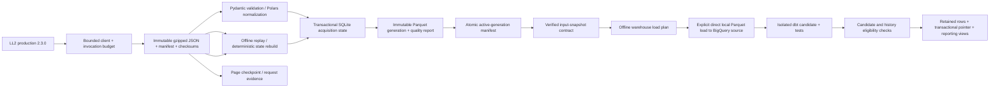
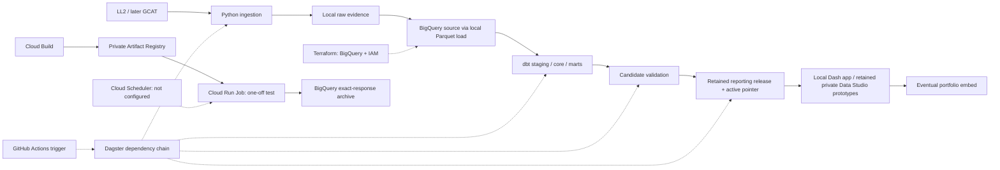

# Architecture

## Purpose and product scope

Space Launch Atlas uses publicly available data to explain worldwide launch activity through interactive visualizations: industry growth, providers and vehicles, outcomes, spaceports, reuse and upcoming schedules. The intended audience is curious visitors and analysts; technical reviewers can trace each metric to its source and grain. It also demonstrates a reproducible data engineering and analytics engineering workflow.

Release 1 focuses on orbital launches from 1957 onward, with the main comparisons from 2000 onward and a 90-day upcoming view. The user confirmed detailed satellite and spacecraft views for release 2; those views require measured payload/source linkage coverage. Orbit tracking and telemetry are outside the current product. [Metric contracts](docs/metrics.md) define what each chart can claim.

## Explicit technology stack

**Reporting decision, 2026-11-21: Plotly Dash with custom HTML/CSS is selected for Printed Atlas.** The app reads the active validated BigQuery edition at runtime and pins its release/snapshot across all pages. Local auth uses short-lived read-only impersonation tokens. The public app is hosted at [https://space-launch-atlas.onrender.com](https://space-launch-atlas.onrender.com/) on the user-created Render service. Hosted auth uses the separate read-only `sla-render-reader` key in Render environment group `space-launch-atlas-reader`; no credential reaches the browser. Temporary policy/tag/admin setup and the local key copy were removed. The user deployed the merged Blueprint on 2026-11-22; public desktop/mobile data loading was verified and scheduled health pings were enabled. Longer operation, hosted memory use, restart recovery and credential refresh remain observations in ROADMAP.md. Existing private Data Studio work is retained as a prototype.

The earlier decision, 2026-11-07, clarified 2026-11-08, selected the no-cost edition of Data Studio (formerly Looker Studio). Data Studio consumes validated BigQuery reporting tables/views; metric logic lives in dbt SQL. It hosts reports/data sources without provisioning a BI server instance. A personal Google account supports report authoring and owner/viewer data credentials; managed Workspace/Cloud Identity is required only for the optional Data Studio service-account credential mode. Account administration and the optional Pro subscription are separate choices. [Product](https://docs.cloud.google.com/data-studio/welcome), [credentials](https://docs.cloud.google.com/data-studio/data-credentials-article).

| Technology | Responsibility | Actual status |
|---|---|---|
| Plotly Dash + Plotly + custom HTML/CSS | Five-page Printed Atlas app following the approved mockup. | App code/assets are in `pipelines/launch_atlas/app`; the `app` uv group includes the app client dependencies and declares Gunicorn for hosting. The `render.yaml` WSGI configuration and hosted-auth mode are prepared. Local reader setup was applied with user approval on 2026-11-21. See ROADMAP.md for status. |
| Render free + GitHub Actions keep-alive | Public hosting for the Dash reader. | Live at [https://space-launch-atlas.onrender.com](https://space-launch-atlas.onrender.com/) after the user deployed the merged Blueprint. HTTPS, exact health body, real BigQuery-backed pages, controls, reload and signed-out/mobile access were checked. Five-minute pings are enabled; the first manual workflow passed. The predeployment Linux process group peaked at 214.4 MiB under 512 MiB / 0.1 CPU; that is not measured Render memory use. See ROADMAP.md for remaining operating observations. |
| Launch Library 2 public API | Primary launch, vehicle, site, schedule and available hardware/landing records. | Initial 1957–2026 history backfill and raw replay audit complete. A manual refresh on 2026-11-14 advanced accepted local state to revision 220 (7,686 launch records, zero conflicts). On 2026-11-15, the worker checkpoint was reconciled to that accepted state and remains `waiting_weekly`; both Windows schedules are disabled. Source pagination remains mutable and does not prove worldwide completeness. |
| GCAT public datasets | Historical cross-check and identifier-linked satellite/payload enrichment. | Planned for release 2, with linkage/coverage review. |
| Python 3.12 | Installed CLI and pipeline execution. | Implemented locally. |
| uv + uv.lock | Environment, package installation and reproducible dependency versions. | Implemented locally. |
| httpx | Bounded HTTP acquisition, pagination, retries and quota handling. | Implemented locally. |
| Pydantic | Typed settings and source-response validation. | Implemented locally. |
| Polars | Normalization, grain-aware tables and local analytical exports. | Implemented locally. |
| Gzipped JSON + SHA-256 | Immutable raw source responses, integrity and replay evidence. | Implemented locally. The 304 archived live responses were checked against local response IDs and checksums; the local raw files remain the recovery source. |
| BigQuery `BYTES` raw-response table | Durable cloud archive of exact LL2 HTTP response bytes and request provenance, one row per HTTP response attempt. | The table has 322 rows: 304 historical local responses, 11 from two Cloud Run executions and seven from the 2026-11-14 manual refresh. The seven new bodies were read back and matched local SHA-256 checksums. The load is idempotent; local replay/recovery remains available. |
| SQLite (standard library) | Transactional current state, sightings/events, conflicts and acquisition progress. | Implemented locally. Durable state/checkpoint storage for a stateless hosted worker is unresolved. |
| Apache Parquet | Typed, portable per-run and revisioned current-state export files. | Implemented locally. |
| Terraform + HashiCorp Google provider | Define BigQuery datasets/tables, required APIs, workload service accounts and least-privilege IAM. | CLI 1.13.1/provider 7.46.2; dataset/IAM and the raw-response table are applied. A read-only refresh plan on 2026-11-11 found no drift. State remains local. |
| Google Cloud Storage (GCS) | Optional object storage for large files/checkpoints. | Not selected for raw responses or the restart proof. No bucket, API enablement or storage IAM is defined in Terraform; Service Usage reports that the Storage API is already enabled in the project. |
| BigQuery | Raw response archive plus curated source, staging, core, marts, reporting and scratch datasets. | Six datasets exist. The raw-response table contains 322 rows: 304 historical local responses, 11 from two Cloud Run executions and seven from the 2026-11-14 manual refresh. Production release `sla-release-v1-46fb47e6c45d91744562b749` is active from revision-220 data frozen on 2026-11-14. Its repinned snapshot is `sla-input-v1-1b061c90a13d0a376e51f50226828cdfb2112e1e584c8fc1388eac13b3c60f9c`; source Parquet hashes and dbt model files match the original candidate. The private report remains bound to production views; its cache has not been refreshed after activation. |
| dbt Core + dbt-bigquery | SQL transformations, metric marts, documentation and warehouse quality tests. | The production run built 31 models and passed 108 dbt tests. The integrated runner caps each query at 100 MB; the standalone profile defaults to an environment-configurable 1 GB cap. |
| Google Cloud CLI + Google user ADC | Interactive local authentication for dbt, Google client libraries and Terraform. | Google Cloud CLI 593.0.0 is installed per-user. ADC was created on 2026-11-11 under `%APPDATA%\gcloud\application_default_credentials.json` with the `cloud-platform` scope; Cloud SQL was not requested. OAuth scope, IAM and user-authorized service use are separate limits. The Desktop OAuth client in Testing is inactive. This is not the unattended runner identity. |
| Dagster + dagster-dbt | Execute the ingest, load, SQL, validation and release dependency chain. | The six-op Dagster job executes in process; dbt runs in an isolated CLI subprocess with retained artifacts. dagster-dbt is installed/locked but is not invoked by this job. The 2026-11-14 candidate passed validation; the local Dagster chain published the revision-220 release on 2026-11-15. No cloud scheduler is configured. |
| GitHub Actions | CI and enabled Render health pings; a Dagster trigger remains future work. | Locked dependencies support offline checks on Linux and Windows. The keep-alive workflow is on `main`, with `RENDER_APP_URL=https://space-launch-atlas.onrender.com` and `RENDER_KEEPALIVE_ENABLED=true`. Its first manual run succeeded. It calls only `/healthz` and has no cloud credentials or data-refresh schedule. |
| Windows Task Scheduler + local Python worker | Resume the finite LL2 history plan, perform a catch-up, audit replay, then run weekly source deltas. | Accepted data and the reconciled worker checkpoint are revision 220 with zero conflicts; the checkpoint is `waiting_weekly`, next action 2026-11-21 11:15 UTC. Both local task registrations were disabled on 2026-11-14 at the user’s request. No scheduled worker or warehouse run is currently active. |
| Cloud Build + Artifact Registry | Build the worker image and retain a private deployable image. | Two worker image versions were built on 2026-11-11. The runtime and build identities use repository-scoped permissions, with no key files. A 2026-11-14 BigQuery preflight showed the active project within its no-cost query and storage allowances; Cloud Run egress costs and future total use remain unverified. |
| Cloud Run Jobs + Cloud Scheduler | Hosted acquisition and its trigger, if later justified. | One unscheduled Cloud Run Job exists. Its deployed image has a request-cap defect and must not be run before redeployment. No Cloud Scheduler or durable hosted checkpoint exists. |
| Data Studio (formerly Looker Studio), no-cost edition | Interactive charts, filters, maps, methodology/freshness and eventual portfolio embedding. | No server instance required. On 2026-11-11 the private five-page report's six embedded sources were rebound to production and showed Functional; the last verified manual refresh displayed release `sla-release-v1-d4f4ae640e0934f11d7ad4c4`. On 2026-11-15 the active BigQuery pointer switched to `sla-release-v1-46fb47e6c45d91744562b749`; the report remains bound to stable production views, but its cache was not manually refreshed after activation. On 2026-11-14 a separate private copy began design iteration on Upcoming and Reuse; the source report and three inherited pages remain unchanged. A precision distribution replaced an unreadable launch timeline; a supported-turnaround histogram replaced a failing timeline. The personal owner/query identity uses its existing project-owner IAM under the user's scoped exception to the read-only rule. No IAM change, sharing, publication or recurring Data Studio refresh was made. The old scratch preview expires 2026-11-16 but is no longer referenced by the production report. |
| pytest, Ruff, Pyright | Python behavior tests, lint/format and type checks. | Run locally; default pytest tests are offline. |
| Terraform fmt / validate / native mock tests | Infrastructure syntax/schema and resource-policy checks without a GCP account. | Run locally; mocks do not prove deployability or cloud IAM. |
| Git + GitHub | Version control for code, contracts, infrastructure and evidence summaries. | Public [RM3006/orbital-pulse](https://github.com/RM3006/orbital-pulse), default branch main. Credentials, raw/state, Terraform state and generated artifacts remain ignored. |

The BigQuery scratch prototype verifies worker recovery at a committed checkpoint. A checkpoint bundles a consistent SQLite backup, plan state, raw manifests and pages, the quota ledger and the current export. BigQuery stores one row per checkpoint digest and chunk index plus a singleton control row. A conditional update grants one owner at a time; another update publishes the verified checkpoint and records completion. An owner that disappears before commit leaves the row locked for review. The prototype does not enable automatic takeover after an ambiguous LL2 request or run as part of the local scheduler. See [Step 4](ROADMAP.md#hosted-worker-and-raw-response-archive-work-started-2026-11-11) for evidence and the deployment cost gate.

## Implemented local dependency chain

Steps 0–3 have a local implementation; the initial history backfill, replay audit and first full-history production warehouse release are complete. The production run used the revision-214 input snapshot; its release manifest is `data/warehouse/runs/e71d2078ba98455c9b16bfbaef16d3c8/release-manifest.json` (ignored). The reporting contract has nine analytical marts and six dimension or bridge relations. Readers select retained rows through a transactional active pointer. When a baseline exists, the candidate checks all 15 relation counts against the active manifest in that namespace. Changes beyond the tolerance of 10% or five rows, whichever is larger, block publication. Terraform manages six datasets, four APIs, scoped identities and the raw-response table; SQLite and local raw files remain necessary for current state and recovery.

`pipeline.ingest` owns acquisition → durable raw → checkpoint → validation/normalization. Explicit plans in `windows.py` freeze query windows, passes, page size and policy. `run_plan` shares a request budget across components. Each accepted run is applied transactionally to SQLite; the plan's progress and complete-window cursor move with its accepted state. Separate content versions, sightings and observation events preserve A→B→A histories while semantic hashes ignore media and counters. Equal source-update timestamps with conflicting semantic content are retained as conflicts rather than silently chosen.

Raw response bodies preserve unknown JSON fields and metadata; images are not downloaded. Checksums cover decompressed response bytes. Request evidence records reservation, send and receipt times, status and non-secret query details. Retries count against a shared local rolling quota. The BigQuery archive stores exact bodies in `BYTES`, not a canonicalized JSON value, plus the validated endpoint and allowlisted query parameters. The initial 304 live response rows from 221 local manifests were reconciled by ID and checksum; 11 rows came from two Cloud Run executions and seven additional exact bodies were verified on 2026-11-14. `warehouse-raw-archive` replays existing local runs idempotently; `worker-tick --archive-raw-to-bigquery` writes each new response before parsing. The local archive remains necessary while durable state/checkpoint migration is unresolved. `rebuild-state` reconstructs accepted live runs from local raw manifests without network. Offline-import runs are excluded by default.

The SQLite database `state/launch_atlas.sqlite` is the current-state/acquisition system of record. It is not the analytical warehouse. Current launch records, launch attempts, semantic observations, per-window coverage and upcoming schedule intervals retain their declared grain. `fact_upcoming_schedule` uses source precision as a half-open interval `[start,end)` and includes only supported intervals overlapping the frozen refresh horizon. Unsupported precision remains in coverage. Launch counts are never multiplied through stages, payloads, families or schedule events.

`state-export` writes a new revisioned Parquet directory. It validates a candidate generation before changing `exports/active.json`; a failed candidate leaves the prior pointer intact. Exported files are derived and can be reconstructed from raw plus policy/versioned code. A completed refresh's frozen as-of timestamp is stored in SQLite and complete refresh manifests so offline rebuild reproduces the same horizon.

`input-snapshot` is an offline Step 3 boundary. It requires the active Parquet generation to match the current SQLite revision and its passing quality report, checks every Parquet checksum/row count, and verifies each accepted source run's manifest and raw page metadata/checksums. The immutable v1 snapshot records source windows and reconciliation, coverage/plans, frozen as-of, parser/hash/event-key versions and a digest of transformation inputs. Its content-derived ID excludes incidental export-generation IDs and creation timestamps; semantically relevant coverage/as-of and file checksums remain part of the identity. This pins inputs locally; it does not upload or load them into GCP.

`warehouse-prepare` verifies the pinned inputs, adds the snapshot key to explicit-schema Parquet copies and writes a deterministic plan. `warehouse-load` rechecks local raw/Parquet checksums, uses explicit file-load schemas and deterministic job IDs, waits for completion, verifies counts and writes a receipt. It loads the 11 typed source relations consumed by dbt; raw JSON archival does not replace those contracts or the Python parser. No raw/GCS upload occurs unless the separate raw-archive command/flag is explicitly selected. Load contract v3 adds an explicit source-dataset override for expiring scratch tests; production defaults stay the same. Prepared paths use a 24-hex directory plus a checked full snapshot identity to avoid Windows path-length failures and reject prefix collisions.

The `models/` project declares snapshot-filtered staging/core/marts with grain/volume checks and nonempty unit examples. Each pipeline invocation uses unique candidate aliases in scratch, preventing concurrent builds from overwriting each other's relations. The runner checks the transformation-code digest before and after dbt, validates matching artifact invocation IDs and successful execution of every enabled model/test, then binds the expected reporting relations to that invocation. The early revision-42 baseline contained 1,744 attempts and 179 upcoming intervals; the full-history production release contains 6,903 launch-attempt rows, 7,713 schedule-movement rows and 179 upcoming intervals as of 2026-11-09T19:31:28Z. Metrics and exclusions live in [docs/metrics.md](docs/metrics.md).

The first release has no prior row-count baseline. Later candidates compare each retained reporting relation to the active manifest using a 10% tolerance with a five-row minimum. Exceeding that threshold records relation-level errors in candidate evidence and blocks activation; a legitimate data correction must be investigated before changing the tolerance or retrying.

`BigQueryReportingStore` extends the metadata backend with release-scoped retained rows, schema/row-count checks and a deterministic SHA-256 multiset digest of row hashes. It verifies the candidate before copying and verifies retained data before activation and rollback. Data is appended idempotently for a release; old rows are not rebuilt from mutable sources. Permanent table/view creation happens before the pointer transaction. Stable reader views reference retained rows, validated metadata and one active pointer, and expose analysis/publication/activation times. The gate rejects incomplete history before any production reporting retention begins. Corrupt manifest identities and changed/missing retained rows are rejected.

`warehouse-run` invokes acquisition (only if a refresh plan is explicitly supplied) → validated export/snapshot → verified load → dbt/tests/content checks → retention → compare-and-swap activation. Without `--publish` it builds and inspects a candidate only. Publishing requires an explicit expected active release; a stale writer cannot replace a newer release. Failures stop dependent operations and save a credential-free `failure.json`. The optional ingestion boundary refuses an incomplete refresh. CLI imports require no credentials; cloud clients are constructed only for explicit cloud commands.

The explicit `--publish --preview` path pins accepted local inputs under the worker lock and runs the same warehouse chain in scratch. It records a preview manifest and an independent `preview_active_release` pointer. The reporting views carry a preview marker and the coverage mart records incomplete history. Production and preview manifests are restricted to their respective release namespaces.

Source scope is explicit: orbital history/refresh queries use `include_suborbital=false`; bounded corrections broaden scope to catch reclassification and retain actual query provenance. Unknown orbital/mission scope remains visible and excluded from orbital attempt facts. A source query's count or a completed query window does not establish worldwide completeness.

## Selected production direction and deployment boundaries

`infra/terraform/` contains declarative resource configuration, a provider lockfile and mock tests. It requires an explicit existing project and BigQuery location; no persistent GCS bucket, Storage API role, or storage IAM is in the current configuration. Terraform defines six BigQuery datasets including expiring scratch, required APIs, separate local-ingest/transform and cloud build/runtime identities, scoped dataset roles, the protected raw-response table, private image repository and one Cloud Run Job. The Cloud Run Job has no scheduler. The optional Data Studio service account remains disabled because service-account credentials require managed Workspace or Cloud Identity eligibility. Terraform owns resource containers/IAM; dbt owns analytical tables/views; the pipeline owns data and release metadata. It does not provision a Looker instance or a Data Studio report. The user authorized the bounded warehouse changes on 2026-11-08 and one worker deployment/run on 2026-11-11. Terraform apply succeeded; a follow-up read-only refresh plan reported no drift.

The Dagster dependency chain remains local. The `OrbitalPulse-LL2` worker and `OrbitalPulse-Warehouse` readiness task were configured as Windows schedules, but both task registrations were disabled on 2026-11-14 at the user’s request. Accepted local state and the reconciled worker checkpoint are at revision 220; the checkpoint is `waiting_weekly` with next action 2026-11-21 11:15 UTC. A manual run on 2026-11-14 refreshed LL2, archived seven exact responses, loaded the typed source tables and passed the candidate dbt/quality checks. It did not publish a release or enable either schedule. A Cloud Run Job exists for explicitly authorized tests, but the deployed image has a request-cap defect and must not be run again until redeployed. There is no Cloud Scheduler or durable hosted checkpoint.

Warehouse publication selects one validated reporting release consistently across marts and retains earlier releases for rollback. The local scheduler compares state, Parquet checksums/row counts, raw source manifests and transformation-file hashes; generated export IDs/timestamps and the repository commit ID do not force a rebuild by themselves. Data Studio can cache chart queries independently, so a warehouse pointer change does not promise simultaneous chart refresh. On 2026-11-11, the private report's six sources were moved from scratch to production and manually refreshed; the coverage table displayed the current release ID and counts. The report remains private and has no scheduled refresh. Its report-specific query bytes have not been isolated from project-wide job usage.

Limitations: offset pagination is mutable. Two-pass comparison and bounded correction overlap reduce risk without proving a provider snapshot or worldwide completeness. Local locks/quota state coordinate processes sharing one data directory, not every public-IP consumer. The initial available history is acquired and reconciled, but completeness is limited to returned LL2 data and project query scope; see [evidence](docs/step2_verification.json) and [roadmap](ROADMAP.md).

BigQuery use was authorized within the monthly free usage limits. The 2026-11-11 preflight observed 29,066,526,720 billed query bytes across 3,108 project jobs and 147,906,785 stored bytes across 545 tables before the release run. The release then billed 681,574,400 bytes across 94 query jobs; all 139 enabled dbt models/tests passed. After publication and manual report refresh, a read-only metadata check observed 31,279,022,080 project query bytes across 3,366 completed query jobs and 179,064,050 stored bytes across 565 tables. These figures include all users/jobs in the configured project, are not report-specific and are not an invoice. Google's 1 TiB query and 10 GiB storage allowances apply per billing account. On 2026-11-11 the user confirmed that no other project uses this account, so the project-level preflight covers current BigQuery use under the stated account scope. Automatic publication requires `BIGQUERY_FREE_TIER_SCOPE=single-project-confirmed` in ignored `.env.local`, now set following that confirmation. The local scheduler applies 20 GiB query and 1 GiB storage reserves to this project's observations, but does not cap Data Studio traffic. The private report uses the personal owner's existing project-owner IAM under the approved exception; no IAM change was made. The report remains private and no website is published; GCS is deferred. See [BigQuery pricing](https://cloud.google.com/bigquery/pricing), [sandbox limits](https://docs.cloud.google.com/bigquery/docs/sandbox) and [connector prerequisites](https://docs.cloud.google.com/data-studio/connect-to-google-bigquery).

Reporting research on 2026-11-08 confirmed an active Free Trial in the billing console; it did not establish an upgraded paid account. Private billing observations remain in ignored evidence. The current ADC could read BigQuery metadata but Cloud Billing metadata returned HTTP 403, so that response is not evidence of disabled billing. The production reporting dataset had no tables at that point. The recorded revision-42 run billed 1,468,006,400 query bytes for dbt and 157,286,400 bytes for candidate inspection: 1.514 GiB before publication/report overhead. A weekly 31-day extrapolation is about 6.7 GiB for that workload. These are estimates from one run, not invoices or forecasts for the completed history. As of 2026-11-08, the user had selected a weekly initial BigQuery refresh and a personal Google account as report owner, but no schedule or report/source had been created. Data Studio extracts remain a possible serving path, not yet selected or tested. They are static snapshots with 100 MB/750,000-row limits and would need metric, size, freshness and cross-source release-consistency tests before use. [Extract behavior/limits](https://docs.cloud.google.com/data-studio/extract-data-for-faster-performance). Local API ingestion can use a different cadence from warehouse builds. Details remain in ROADMAP.md and the ignored Step 3 verification JSON.

Step 5 identity and report check (2026-11-09): the personal account completed Data Studio setup, authorized its BigQuery connector and owns the private report. The user explicitly accepted the account's existing project `roles/owner` and scratch-dataset `OWNER` permissions for this report as a scoped exception to the read-only reporting rule; no IAM change was made. At that date the five pages queried six revision-95 scratch views and showed incomplete-history limitations. The coverage summary returned 4,341 orbital attempts, 230 unknown-scope records, zero unresolved attempt outcomes and 33 upcoming records with unsupported precision; the upcoming manifest returned 179 rows. The scratch preview expires on 2026-11-16. This is historical evidence; the current production binding and refresh verification are recorded in ROADMAP.md.

## Local Printed Atlas reader

`python -m launch_atlas.app` binds only to `127.0.0.1:8050`. Imports and the app factory require no credentials. The initial page-load callback resolves `active_release` and its validated manifest using metadata reads, then loads one parameterized SELECT across the retained reporting relations plus the snapshot-matched launch-label source table. Row counts, snapshot/release identities and label uniqueness are checked before an edition enters the process-local cache. Reloading the same release uses that cache; a failed reload preserves the previous page. Caches are never substituted with disk extracts or mockup example data.

The browser receives rendered visual data and an edition ID. Filter callbacks only use already validated server-held editions. Annual counts use Plotly; exact date-window tracks, flight strips, tables, disclosures and native selects use custom HTML/CSS. Fonts are bundled from the approved design export. The spaceport map uses Plotly's MapLibre `Scattermap` with attributed CARTO/OpenStreetMap tiles, pan/zoom controls and a Florida close-up; tile requests come from the browser and need no application access token. Markers retain the source coordinates. Map markers and selector options cover every located site with orbital activity since January 2024 (27 in the current edition); the six-site preview remains only in the busiest-site heatmap. Unlocated activity remains in the supporting site table. World view fits the mapped latitude range with a 2:1 responsive aspect ratio, keeping northern sites visible; local site views retain their detailed zoom. Client-side MapLibre initialization disables repeated world copies, fits one world to a responsive map capped at 1100 px, and preserves interactive zoom/pan until a view control explicitly resets it.

The reader includes the retained configuration/family bridge and snapshot-matched source launch context. Context lists preserve multiple family memberships and providers observed on launches; they do not multiply outcome aggregates. The reuse page selects one hardware serial and restores its full flight strip/log; provider/configuration/family context is derived from that serial's recorded flights and displayed as a compact value line with smaller grey labels underneath. Fleet landing and hardware coverage cards remain independent. Outcome pagination/search, complete-year comparisons, ascending reported windows and planned-launch charts operate entirely on the cached edition. Provider/configuration chart totals partition distinct manifest entries, while family bars may overlap and are explicitly non-additive.

The dedicated `sla-app-reader` identity has BigQuery Job User and Data Viewer on only the reporting and source datasets. Source access supplies the snapshot-specific launch labels until these are retained in a reporting relation. The approved local operator can impersonate only this reader; the app requests `bigquery.readonly` access tokens and uses `jobs.query`, because `jobs.insert` requires a broader OAuth scope. No service-account key is created. All query SQL is server-owned and SELECT-only. Each full-edition query is dry-run and capped at 250 MB; this cap is not a monthly billing-account limit. Current month headroom was checked before live local validation.
