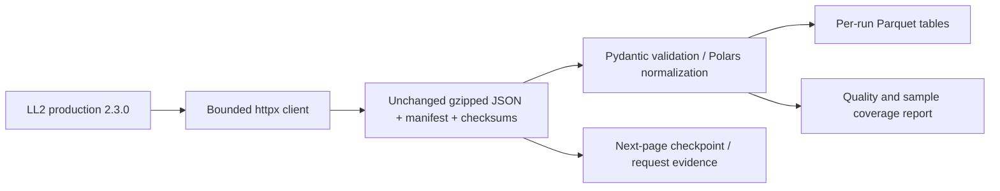

# Architecture

Implemented locally, Phase 0–1. All state stays in the selected data directory.

`pipeline.ingest` owns acquisition → durable raw → checkpoint → `replay` → normalization/quality. CLI entry points call it; default tests inject HTTP transports without reaching the network. `replay` and `import-raw` work without credentials or API access. Imports have no side effects.

Raw response bodies include unknown JSON fields and source image metadata; images themselves are neither downloaded nor used. Checksums cover decompressed response bytes. Status, endpoint, non-secret query, observed time, parser/API version and response metadata accompany every returned response, including failures. Source update times stay on normalized launch observations. A conservative rolling request ledger is reserved before each HTTP attempt; transport failures consume budget too.

Each run is isolated. `launch_record_current` and `fact_launch_attempt` are distinct. Provider, configuration, family, configuration-family bridge, pad, site, hardware-flight and observation tables have explicit keys (see docs/data_sources.md). Semantic deduplication and correction precedence apply within a run; media/counter-only changes do not create observations. Dimensions reflect the latest source record encountered, not historical slowly changing attributes. There is no global current store or cross-run change ledger yet. Unknown mission/orbit scope is retained in current records and coverage, excluded from the attempt fact; the source filter alone proved insufficient for missing-orbit records.

An exclusive directory lock serializes writers and quota reservations for that root. Atomic JSON replacement protects checkpoints. Raw files are immutable; a checksum suffix permits retries after a crash between raw writing and manifest commit. Derived Parquet is replaceable, run-local output, not a published reporting release. A partial run is explicitly labeled incomplete even if its fetched rows pass quality checks.

Proposed production architecture remains GCS → BigQuery → dbt → candidate validation → retained release tables + one active-release pointer → Data Studio. A future Dagster asset job will wrap this same ingestion function and include load, dbt, validation and publication; scheduled GitHub Actions will invoke it. Neither a daemon nor a schedule exists today. Dagster/dbt/cloud adapters are intentionally not installed before their executable stages exist; this is sequencing, not a switch to another architecture. No BigQuery SQL, cloud identity or release rollback is validated by Python tests.

Limitations: offset pagination is mutable, not a source snapshot; an interruption can overlap or miss moving records. Within-run dedup prevents repeated IDs but does not prove historical completeness. Phase 2 must add overlap/reconciliation, cross-run semantic observations and full-window watermarks. Local locks/quotas cannot coordinate other machines or other consumers sharing the public IP. Upstream throttling remains authoritative. Upcoming scope currently filters the source NET placeholder; precision-period overlap is not yet implemented.
