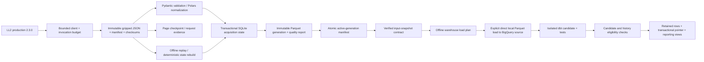
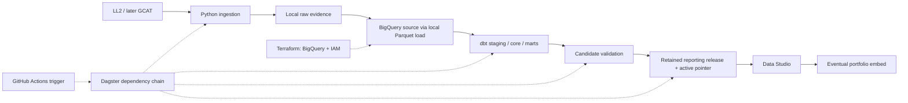

# Architecture

## Purpose and product scope

Space Launch Atlas uses publicly available data to explain worldwide launch activity through interactive visualizations: industry growth, providers and vehicles, outcomes, spaceports, reuse and upcoming schedules. The intended audience is curious visitors and analysts; technical reviewers can trace each metric to its source and grain. It also demonstrates a reproducible data engineering and analytics engineering workflow.

Release 1 focuses on orbital launches from 1957 onward, with the main comparisons from 2000 onward and a 90-day upcoming view. The user confirmed detailed satellite and spacecraft views for release 2; those views require measured payload/source linkage coverage. Orbit tracking and telemetry are outside the current product. [Metric contracts](docs/metrics.md) define what each chart can claim.

## Explicit technology stack

**Reporting decision, 2026-11-07, clarified 2026-11-08: the no-cost edition of Data Studio (formerly Looker Studio) is selected.** Data Studio consumes validated BigQuery reporting tables/views; metric logic lives in dbt SQL. It hosts reports/data sources without provisioning a BI server instance. A personal Google account supports report authoring and owner/viewer data credentials; managed Workspace/Cloud Identity is required only for the optional Data Studio service-account credential mode. Account administration and the optional Pro subscription are separate choices. [Product](https://docs.cloud.google.com/data-studio/welcome), [credentials](https://docs.cloud.google.com/data-studio/data-credentials-article).

| Technology | Responsibility | Actual status |
|---|---|---|
| Launch Library 2 public API | Primary launch, vehicle, site, schedule and available hardware/landing records. | Live local extraction verified; full-history acquisition incomplete. |
| GCAT public datasets | Historical cross-check and identifier-linked satellite/payload enrichment. | Planned for release 2, with linkage/coverage review. |
| Python 3.12 | Installed CLI and pipeline execution. | Implemented locally. |
| uv + uv.lock | Environment, package installation and reproducible dependency versions. | Implemented locally. |
| httpx | Bounded HTTP acquisition, pagination, retries and quota handling. | Implemented locally. |
| Pydantic | Typed settings and source-response validation. | Implemented locally. |
| Polars | Normalization, grain-aware tables and local analytical exports. | Implemented locally. |
| Gzipped JSON + SHA-256 | Immutable raw source responses, integrity and replay evidence. | Implemented on local filesystem. |
| SQLite (standard library) | Transactional local current state, sightings/events, conflicts and acquisition progress. | Implemented locally; cross-machine deployment of this state remains to be designed. |
| Apache Parquet | Typed, portable per-run and revisioned current-state export files. | Implemented locally. |
| Terraform + HashiCorp Google provider | Define six BigQuery datasets, required APIs, workload service accounts and least-privilege IAM. | CLI 1.13.1/provider 7.46.2; applied to the existing project on 2026-11-08. A follow-up refresh plan reported no drift. Local state only; no GCS. |
| Google Cloud Storage (GCS) | Possible future shared raw archive. | Deferred to keep raw files local and avoid storage costs. No bucket/API/IAM is defined or deployed. |
| BigQuery | Warehouse source, staging, core, marts, reporting and scratch datasets. | Six datasets exist. The latest revision-42 snapshot's 11 Parquet tables loaded with deterministic local-file jobs and verified row counts. Analytical builds and release verification use scratch. Production reporting remains inactive because history is incomplete. |
| dbt Core + dbt-bigquery | SQL transformations, metric marts, documentation and warehouse quality tests. | 31 models, 11 sources, 102 data tests and 6 unit tests. All ran successfully on revision 42 in scratch. The integrated runner caps each query at 100 MB; the standalone profile defaults to an environment-configurable 1 GB cap. |
| Google Cloud CLI + Google user ADC | Interactive local authentication for dbt, Google client libraries and Terraform. | ADC was created by gcloud 592.0.0 and is stored under the Windows user profile. The OAuth grant requests `cloud-platform` only; Cloud SQL was not requested. It is used for authorized BigQuery and bounded Terraform project operations; OAuth scope, IAM and user-authorized service use are separate limits. The Desktop OAuth client in Testing is inactive. This is not the unattended runner identity. |
| Dagster + dagster-dbt | Execute the ingest, load, SQL, validation and release dependency chain. | The six-op Dagster job executes in process; dbt runs in an isolated CLI subprocess with retained artifacts. dagster-dbt is installed/locked but is not invoked by this job. The earlier Windows stall was sandbox-blocked asyncio loopback, verified by a stack trace and successful execution outside that sandbox. No schedule. |
| GitHub Actions | CI, then the future scheduled trigger for the Dagster job. | Locked warehouse dependencies are installed for type checks and offline tests on Linux and Windows; both platforms verified. No data-refresh schedule or cloud credentials in CI. |
| Data Studio (formerly Looker Studio), no-cost edition | Interactive charts, filters, maps, methodology/freshness and eventual portfolio embedding. | No server instance required. Signed-in home inspected; Data Studio API authorization is pending. No report/data source created or published. Personal ownership is recommended; the read-only data-credential principal is undecided. |
| pytest, Ruff, Pyright | Python behavior tests, lint/format and type checks. | Run locally; default pytest tests are offline. |
| Terraform fmt / validate / native mock tests | Infrastructure syntax/schema and resource-policy checks without a GCP account. | Run locally; mocks do not prove deployability or cloud IAM. |
| Git + GitHub | Version control for code, contracts, infrastructure and evidence summaries. | Public [RM3006/orbital-pulse](https://github.com/RM3006/orbital-pulse), default branch main. Credentials, raw/state, Terraform state and generated artifacts remain ignored. |

## Implemented local dependency chain

Steps 0–2 have a local implementation; Step 2 acquisition remains incomplete. Revision 42 now loads and builds through the same executable Dagster chain. Nine analytical marts and six dimension/bridge relations form the reporting contract. Reporting rows are retained independently of candidate relations, then selected by one transactional pointer. Production activation is blocked by incomplete history; bounded complete fixtures exercise the release path in scratch. Terraform manages six datasets, four APIs and scoped identities. Local raw/state remains under `data/`; no GCS archive, schedule or public report exists.

`pipeline.ingest` owns acquisition → durable raw → checkpoint → validation/normalization. Explicit plans in `windows.py` freeze query windows, passes, page size and policy. `run_plan` shares a request budget across components. Each accepted run is applied transactionally to SQLite; the plan's progress and complete-window cursor move with its accepted state. Separate content versions, sightings and observation events preserve A→B→A histories while semantic hashes ignore media and counters. Equal source-update timestamps with conflicting semantic content are retained as conflicts rather than silently chosen.

Raw response bodies preserve unknown JSON fields and metadata; images are not downloaded. Checksums cover decompressed response bytes. Request evidence records reservation, send and receipt times, status and non-secret query details. Retries count against a shared local rolling quota. Raw data remains filesystem-backed and replayable; `rebuild-state` reconstructs accepted live runs without network. Offline-import runs are excluded unless explicitly selected by run ID.

The SQLite database `state/launch_atlas.sqlite` is the current-state/acquisition system of record. It is not the analytical warehouse. Current launch records, launch attempts, semantic observations, per-window coverage and upcoming schedule intervals retain their declared grain. `fact_upcoming_schedule` uses source precision as a half-open interval `[start,end)` and includes only supported intervals overlapping the frozen refresh horizon. Unsupported precision remains in coverage. Launch counts are never multiplied through stages, payloads, families or schedule events.

`state-export` writes a new revisioned Parquet directory. It validates a candidate generation before changing `exports/active.json`; a failed candidate leaves the prior pointer intact. Exported files are derived and can be reconstructed from raw plus policy/versioned code. A completed refresh's frozen as-of timestamp is stored in SQLite and complete refresh manifests so offline rebuild reproduces the same horizon.

`input-snapshot` is an offline Step 3 boundary. It requires the active Parquet generation to match the current SQLite revision and its passing quality report, checks every Parquet checksum/row count, and verifies each accepted source run's manifest and raw page metadata/checksums. The immutable v1 snapshot records source windows and reconciliation, coverage/plans, frozen as-of, parser/hash/event-key versions and a digest of transformation inputs. Its content-derived ID excludes incidental export-generation IDs and creation timestamps; semantically relevant coverage/as-of and file checksums remain part of the identity. This pins inputs locally; it does not upload or load them into GCP.

`warehouse-prepare` verifies the pinned inputs, adds the snapshot key to explicit-schema Parquet copies and writes a deterministic plan. `warehouse-load` rechecks local raw/Parquet checksums, uses explicit file-load schemas and deterministic job IDs, waits for completion, verifies counts and writes a receipt. No raw/GCS upload occurs. Load contract v3 adds an explicit source-dataset override for expiring scratch tests; production defaults stay the same. Prepared paths use a 24-hex directory plus a checked full snapshot identity to avoid Windows path-length failures and reject prefix collisions.

The `models/` project declares snapshot-filtered staging/core/marts with grain/volume checks and nonempty unit examples. Each pipeline invocation uses unique candidate aliases in scratch, preventing concurrent builds from overwriting each other's relations. The runner checks the transformation-code digest before and after dbt, validates matching artifact invocation IDs and successful execution of every enabled model/test, then binds the expected reporting relations to that invocation. Revision 42 produced 1,744 attempts, 2,088 schedule-observation rows and 179 upcoming intervals. Its 16 flown stage associations cover 14 qualifying attempts; field presence and actual recorded stage coverage are distinct. Metrics and exclusions live in [docs/metrics.md](docs/metrics.md).

`BigQueryReportingStore` extends the metadata backend with release-scoped retained rows, schema/row-count checks and a deterministic SHA-256 multiset digest of row hashes. It verifies the candidate before copying and verifies retained data before activation and rollback. Data is appended idempotently for a release; old rows are not rebuilt from mutable sources. Permanent table/view creation happens before the pointer transaction. Stable reader views reference retained rows, validated metadata and one active pointer, and expose analysis/publication/activation times. The gate rejects incomplete history before any production reporting retention begins. Corrupt manifest identities and changed/missing retained rows are rejected.

`warehouse-run` invokes acquisition (only if a refresh plan is explicitly supplied) → validated export/snapshot → verified load → dbt/tests/content checks → retention → compare-and-swap activation. Without `--publish` it builds and inspects a candidate only. Publishing requires an explicit expected active release; a stale writer cannot replace a newer release. Failures stop dependent operations and save a credential-free `failure.json`. The optional ingestion boundary refuses an incomplete refresh. CLI imports require no credentials; cloud clients are constructed only for explicit cloud commands.

Source scope is explicit: orbital history/refresh queries use `include_suborbital=false`; bounded corrections broaden scope to catch reclassification and retain actual query provenance. Unknown orbital/mission scope remains visible and excluded from orbital attempt facts. A source query's count or a completed query window does not establish worldwide completeness.

## Selected production direction and deployment boundaries

`infra/terraform/` contains declarative resource configuration, a provider lockfile and mock tests. It requires an explicit existing project and BigQuery location; no GCS bucket, Storage API, or storage IAM is in the current configuration. Terraform defines six BigQuery datasets including expiring scratch, four APIs, separate ingest/transform identities and scoped dataset roles. The optional Data Studio service account remains disabled because service-account credentials require managed Workspace or Cloud Identity eligibility. Terraform owns resource containers/IAM; dbt owns analytical tables/views; the pipeline owns data and release metadata. It does not provision a Looker instance or a Data Studio report. The user authorized the bounded project changes on 2026-11-08; the plan was applied and the subsequent refresh plan was clean.

The Dagster dependency chain now runs locally; scheduling it is Step 4. Local cloud commands use user ADC. Workload service accounts are not yet configured as unattended runners. A scheduler alone does not persist SQLite, checkpoints or quota history; choose persistence and keyless CI identity before enabling a schedule. Offline tests permit local loopback only for explicitly marked asyncio tests and block external sockets. No credentials are needed for local Python, dbt parse or Terraform mock checks.

Warehouse publication must select one validated reporting release consistently across marts and retain earlier releases for rollback. Data Studio can cache chart queries independently, so a warehouse pointer change does not promise simultaneous chart refresh. Show release/freshness information and verify actual report/cache and signed-out embed behavior before publication.

Limitations: offset pagination is mutable. Two-pass comparison and bounded correction overlap reduce risk without proving a provider snapshot or worldwide completeness. Local locks/quota state coordinate processes sharing one data directory, not every public-IP consumer. Historical acquisition remains incomplete; see [evidence](docs/step2_verification.json) and [roadmap](ROADMAP.md).

BigQuery usage is authorized within the active trial's monthly free allowances. Current verification records source-load receipts, dbt artifacts, query-job evidence, actual project usage and independent local/warehouse count checks under ignored `data/warehouse/`; the roadmap summarizes them. Pipeline queries are capped at 100 MB, and the combined 15-view scratch reader uses 250 MB to cover per-table minimums. These limits do not cap Data Studio traffic or project-wide monthly spend. Reporting identity/cost and post-trial operation remain open; no report/website is published, and GCS is deferred. See [BigQuery pricing](https://cloud.google.com/bigquery/pricing), [sandbox limits](https://docs.cloud.google.com/bigquery/docs/sandbox) and [connector prerequisites](https://docs.cloud.google.com/data-studio/connect-to-google-bigquery).

Reporting research on 2026-11-08 confirmed an active Free Trial in the billing console; it did not establish an upgraded paid account. Private billing observations remain in ignored evidence. The current ADC could read BigQuery metadata but Cloud Billing metadata returned HTTP 403, so that response is not evidence of disabled billing. The reporting dataset contains no tables. The recorded revision-42 run billed 1,468,006,400 query bytes for dbt and 157,286,400 bytes for candidate inspection: 1.514 GiB before publication/report overhead. An hourly 31-day extrapolation is 1.100 TiB; daily is 46.924 GiB. These are workload estimates from one run, not invoices or forecasts for the completed history. Daily full warehouse/report refresh and Data Studio extracts are proposed for the initial public serving path; they are not configured. Extracts are static snapshots with 100 MB/750,000-row limits and need metric, size, freshness and cross-source release-consistency tests before selection. [Extract behavior/limits](https://docs.cloud.google.com/data-studio/extract-data-for-faster-performance). Local API ingestion can use a different cadence from warehouse builds. Details remain in ROADMAP.md and the ignored Step 3 verification JSON.
