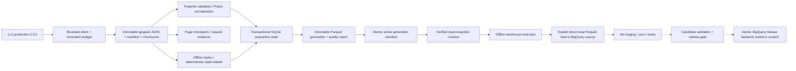
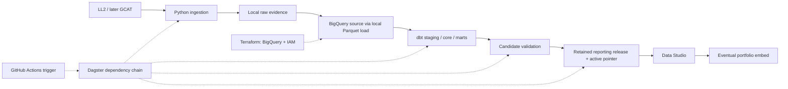

# Architecture

## Purpose and product scope

Space Launch Atlas uses publicly available data to explain worldwide launch activity through interactive visualizations: industry growth, providers and vehicles, outcomes, spaceports, reuse and upcoming schedules. The intended audience is curious visitors and analysts; technical reviewers can trace each metric to its source and grain. It also demonstrates a reproducible data engineering and analytics engineering workflow.

Release 1 focuses on orbital launches from 1957 onward, with the main comparisons from 2000 onward and a 90-day upcoming view. The user confirmed detailed satellite and spacecraft views for release 2; those views require measured payload/source linkage coverage. Orbit tracking and telemetry are outside the current product. [Metric contracts](docs/metrics.md) define what each chart can claim.

## Explicit technology stack

**Reporting decision, 2026-11-07: Data Studio (formerly Looker Studio) is selected.** Data Studio consumes validated BigQuery reporting tables/views; metric logic lives in dbt SQL. Looker licenses and LookML models are not part of this design. [Google product documentation](https://docs.cloud.google.com/data-studio/welcome).

| Technology | Responsibility | Actual status |
|---|---|---|
| Launch Library 2 public API | Primary launch, vehicle, site, schedule and available hardware/landing records. | Live local extraction verified; full-history acquisition incomplete. |
| GCAT public datasets | Historical cross-check and identifier-linked satellite/payload enrichment. | Planned for release 2, with linkage/coverage review. |
| Python 3.12 | Installed CLI and pipeline execution. | Implemented locally. |
| uv + uv.lock | Environment, package installation and reproducible dependency versions. | Implemented locally. |
| httpx | Bounded HTTP acquisition, pagination, retries and quota handling. | Implemented locally. |
| Pydantic | Typed settings and source-response validation. | Implemented locally. |
| Polars | Normalization, grain-aware tables and local analytical exports. | Implemented locally. |
| Gzipped JSON + SHA-256 | Immutable raw source responses, integrity and replay evidence. | Implemented on local filesystem. |
| SQLite (standard library) | Transactional local current state, sightings/events, conflicts and acquisition progress. | Implemented locally; cross-machine deployment of this state remains to be designed. |
| Apache Parquet | Typed, portable per-run and revisioned current-state export files. | Implemented locally. |
| Terraform + HashiCorp Google provider | Define six BigQuery datasets, required APIs, workload service accounts and least-privilege IAM. | CLI 1.13.1/provider 7.46.2; applied to the existing project on 2026-11-08. A follow-up refresh plan reported no drift. Local state only; no GCS. |
| Google Cloud Storage (GCS) | Possible future shared raw archive. | Deferred to keep raw files local and avoid storage costs. No bucket/API/IAM is defined or deployed. |
| BigQuery | Warehouse source, staging, core, marts, reporting and scratch datasets. | Six datasets exist. The 11 revision-27 source Parquet tables were loaded with the local-file adapter; 11 load jobs and table row counts were verified. dbt models/tests ran in scratch. Reporting remains empty because history is incomplete. |
| dbt Core + dbt-bigquery | SQL transformations, metric marts, documentation and warehouse quality tests. | Optional locked dependencies; 26 models, 11 sources and 80 tests parse offline. All 26 models and 80 tests plus one unit test passed against BigQuery scratch. Local ADC and `dbt debug` pass; each query job has a 1,000,000,000-byte billed cap. |
| Google Cloud CLI + Google user ADC | Interactive local authentication for dbt, Google client libraries and Terraform. | ADC was created by gcloud 592.0.0 and is stored under the Windows user profile. The OAuth grant requests `cloud-platform` only; Cloud SQL was not requested. It is used for authorized BigQuery and bounded Terraform project operations; OAuth scope, IAM and user-authorized service use are separate limits. The Desktop OAuth client in Testing is inactive. This is not the unattended runner identity. |
| Dagster + dagster-dbt | Proposed dependency chain for ingest, load, SQL, quality and publication. | Optional dependencies are installed/locked. A local snapshot→plan job graph imports and passes dependency-wiring checks, but its execution stalled before the first step on Windows, as did a trivial no-op job. Full-chain execution and any schedule are unverified. |
| GitHub Actions | CI, then the future scheduled trigger for the Dagster job. | Python CI authored; remote CI unverified; no data-refresh schedule. |
| Data Studio (formerly Looker Studio) | Interactive charts, filters, maps, methodology/freshness and eventual portfolio embedding. | Selected by user; no report created or published. |
| pytest, Ruff, Pyright | Python behavior tests, lint/format and type checks. | Run locally; default pytest tests are offline. |
| Terraform fmt / validate / native mock tests | Infrastructure syntax/schema and resource-policy checks without a GCP account. | Run locally; mocks do not prove deployability or cloud IAM. |
| Git | Version control for code, contracts, infrastructure and evidence summaries. | Local repository; no remote configured. |

## Implemented local dependency chain

Steps 0–2 have a local implementation; Step 2 historical acquisition remains incomplete. Step 3 has a verified revision-27 warehouse snapshot, deterministic local-file BigQuery load, a dbt build and passing warehouse tests in scratch, plus a transaction-tested BigQuery release backend. Local state has since advanced to revision 42; BigQuery has not been refreshed from it. Terraform manages six datasets, four APIs and scoped service identities. No release is published, GCS archive is created, schedule is running or public report is connected. Local raw/state remains under `data/` by default.

`pipeline.ingest` owns acquisition → durable raw → checkpoint → validation/normalization. Explicit plans in `windows.py` freeze query windows, passes, page size and policy. `run_plan` shares a request budget across components. Each accepted run is applied transactionally to SQLite; the plan's progress and complete-window cursor move with its accepted state. Separate content versions, sightings and observation events preserve A→B→A histories while semantic hashes ignore media and counters. Equal source-update timestamps with conflicting semantic content are retained as conflicts rather than silently chosen.

Raw response bodies preserve unknown JSON fields and metadata; images are not downloaded. Checksums cover decompressed response bytes. Request evidence records reservation, send and receipt times, status and non-secret query details. Retries count against a shared local rolling quota. Raw data remains filesystem-backed and replayable; `rebuild-state` reconstructs accepted live runs without network. Offline-import runs are excluded unless explicitly selected by run ID.

The SQLite database `state/launch_atlas.sqlite` is the current-state/acquisition system of record. It is not the analytical warehouse. Current launch records, launch attempts, semantic observations, per-window coverage and upcoming schedule intervals retain their declared grain. `fact_upcoming_schedule` uses source precision as a half-open interval `[start,end)` and includes only supported intervals overlapping the frozen refresh horizon. Unsupported precision remains in coverage. Launch counts are never multiplied through stages, payloads, families or schedule events.

`state-export` writes a new revisioned Parquet directory. It validates a candidate generation before changing `exports/active.json`; a failed candidate leaves the prior pointer intact. Exported files are derived and can be reconstructed from raw plus policy/versioned code. A completed refresh's frozen as-of timestamp is stored in SQLite and complete refresh manifests so offline rebuild reproduces the same horizon.

`input-snapshot` is an offline Step 3 boundary. It requires the active Parquet generation to match the current SQLite revision and its passing quality report, checks every Parquet checksum/row count, and verifies each accepted source run's manifest and raw page metadata/checksums. The immutable v1 snapshot records source windows and reconciliation, coverage/plans, frozen as-of, parser/hash/event-key versions and a digest of transformation inputs. Its content-derived ID excludes incidental export-generation IDs and creation timestamps; semantically relevant coverage/as-of and file checksums remain part of the identity. This pins inputs locally; it does not upload or load them into GCP.

`warehouse-prepare` verifies the pinned inputs, adds the snapshot key to explicit-schema local Parquet copies, and writes a deterministic plan. `warehouse-load` is an explicit cloud-write command: it rechecks local raw and Parquet checksums, uses BigQuery file-load jobs with deterministic IDs, waits for completion, verifies output row counts and writes a local receipt. It uploads no raw files and uses no GCS. The revision-27 receipt lists 76 locally verified artifacts and 11 loaded tables; BigQuery job/table metadata confirmed the counts. The 11 inputs total 364,122 bytes and the table metadata reports 1,574,840 stored bytes. A Dagster snapshot→plan graph remains definition-tested only; Windows runtime execution did not progress to its first step.

The `models/` dbt project declares snapshot-filtered source/staging/core/mart models and grain/volume tests. On revision 27, all 26 models ran in `space_launch_atlas_scratch`: 15 tables and 11 views, including 776 launch attempts. All 80 dbt data tests passed, plus a BigQuery unit test that checks separate success, failure, partial-failure and unresolved counts. The typed accepted-values tests use unquoted numeric/boolean values for BigQuery types. No production reporting release was built because the pinned input remains ineligible while historical windows are incomplete.

`BigQueryReleaseBackend` creates metadata and active-pointer tables outside transactions, then uses BigQuery multi-statement transactions for expected-value publish and rollback. An opt-in integration test created only seven-day scratch tables and exercised two retained synthetic manifests, stale-publisher rejection and rollback. This backend stores metadata; materializing retained reporting data, release-filtered reader views and the full load → dbt → checks → publication chain remain unimplemented. No production reporting metadata table, active pointer or release row has been created. The Python release gate rejects candidates with incomplete input coverage.

Source scope is explicit: orbital history/refresh queries use `include_suborbital=false`; bounded corrections broaden scope to catch reclassification and retain actual query provenance. Unknown orbital/mission scope remains visible and excluded from orbital attempt facts. A source query's count or a completed query window does not establish worldwide completeness.

## Selected production direction and deployment boundaries

`infra/terraform/` contains declarative resource configuration, a provider lockfile and mock tests. It requires an explicit existing project and BigQuery location; no GCS bucket, Storage API, or storage IAM is in the current configuration. Terraform defines six BigQuery datasets including expiring scratch, four APIs, separate ingest/transform identities and scoped dataset roles. The optional Data Studio service account remains disabled because service-account credentials require managed Workspace or Cloud Identity eligibility. Terraform owns resource containers/IAM; dbt owns analytical tables/views; the pipeline owns data and release metadata. It does not provision a Looker instance or a Data Studio report. The user authorized the bounded project changes on 2026-11-08; the plan was applied and the subsequent refresh plan was clean.

A full Dagster job should eventually wrap ingestion/load/dbt/check/publication and scheduled GitHub Actions should invoke that chain. The current local graph only covers snapshot→plan; Dagster runtime execution is unverified. Local cloud runs currently use the user's ADC; the created workload service accounts are not yet configured as an unattended runner. A scheduler trigger alone does not persist SQLite, checkpoints or quota history between runners. These are Step 3–4 implementation and deployment decisions. No cloud credentials are required for local Python, dbt parse or Terraform mock checks.

Warehouse publication must select one validated reporting release consistently across marts and retain earlier releases for rollback. Data Studio can cache chart queries independently, so a warehouse pointer change does not promise simultaneous chart refresh. Show release/freshness information and verify actual report/cache and signed-out embed behavior before publication.

Limitations: offset pagination is mutable, so two-pass comparison and bounded correction overlap reduce but cannot prove provider snapshot completeness. Current local quota/locks coordinate only processes sharing one data directory, not every consumer using the public IP. Historical acquisition remains incomplete; see [evidence](docs/step2_verification.json) and the [current roadmap](ROADMAP.md). The user authorized Terraform changes and BigQuery usage within the active Free Trial's 1 TiB/month query and 10 GiB/month storage limits. Current load evidence records 364,122 local input bytes, 1,574,840 stored table bytes and matching row counts for all 11 tables. dbt scratch artifacts report per-job processing and have a 1 GB billed-byte cap. No Data Studio connection is configured because the connector has no per-chart bytes-billed cap and may incur costs; no public release or website is published. GCS is deferred. Local ADC uses the user-approved `cloud-platform` OAuth grant. The post-trial and reporting cost path remain open. See [BigQuery pricing](https://cloud.google.com/bigquery/pricing), [sandbox limits](https://docs.cloud.google.com/bigquery/docs/sandbox) and [connector prerequisites](https://docs.cloud.google.com/data-studio/connect-to-google-bigquery).
