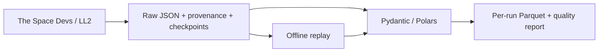

# Space Launch Atlas — The Industrialization of Space

**How is access to orbit changing — who launches, how reliably, and with how much reuse?**

Phase 0–1 is implemented locally: a Python CLI ingests public Launch Library 2 data into immutable raw JSON, resumes saved page checkpoints, and replays validated, normalized Parquet without network access. It separates launch attempts from upcoming schedules, hardware flights, and source missingness. No website, warehouse, schedule or public reporting release is running.



Live verification on **1 November 2026** fetched a complete 1957 query (three attempts: two successes and one failure) and a source-NET-bounded 90-day upcoming query (106 records over two pages). The upcoming run timed out once, stopped at its two-request budget, then completed with one-request resume. It preserves coarse date precision and flags **19 unknown-scope records**, excluded from the orbital denominator. These are extraction observations, not a worldwide reliability finding. The source's orbital filter alone did not resolve missing-orbit HASTE entries; [methodology and evidence](docs/data_sources.md) explain the conservative scope rule.

Install and check:

```powershell
uv sync --locked
uv run ruff check .
uv run ruff format --check .
uv run pyright
uv run pytest -m "not integration and not live" --basetemp data/test-tmp
uv run python -m launch_atlas doctor --offline
```

Reproduce the genuine 1957 raw-to-Parquet slice offline:

```powershell
uv run python -m launch_atlas import-raw --input tests/fixtures/ll2_history_1957.json --observed-at 2026-11-01T17:04:49.556708+00:00 --orbital-only --run-id demo-1957
uv run python -m launch_atlas replay --run-id demo-1957
```

Output: `data/raw/ll2/demo-1957/` and `data/normalized/demo-1957/` (ten Parquet tables plus quality.json). For an existing demo ID, run replay directly. `uv run python -m launch_atlas --help` lists only implemented commands. An explicit live smoke command is `uv run python -m launch_atlas smoke --source ll2 --max-requests 2`; default tests never call the source. See [setup](SETUP.md) for Windows/Linux commands, request budgets, safe resume, environment variables and exit codes.

Current verification: **39 substantive offline tests**, ruff lint/format, pyright, locked install and wheel build pass on Windows/Python 3.12. Tests cover real source data, outcome denominators, corrections/dedup, coarse precision, hardware/payload grains, nulls, raw integrity, retries/throttling, safe pagination and interrupted page resume. CI is configured for Windows/Linux with no source API or cloud access during tests; it has not run on GitHub. See [handoff](docs/handoff.md) for the exact final checks and boundaries.

Next local work is Phase 2: persistent observations across runs, historical reconciliation, complete-window watermarks and coarse scheduling-period overlap. Proposed production remains **GCS + BigQuery + dbt**, **Dagster invoked by scheduled GitHub Actions**, and **Google Data Studio**, subject to account, spend and reporting-product decisions. Those services/adapters are not installed or provisioned yet. [Architecture](ARCHITECTURE.md), [decisions](docs/decisions.md), [metrics](docs/metrics.md), [operations](docs/operations.md), and [roadmap](ROADMAP.md) distinguish implementation from plans.

Code: MIT. Source data: [The Space Devs](https://thespacedevs.com/llapi), subject to its own [terms](https://github.com/TheSpaceDevs/Tutorials/blob/main/faqs/faq_TSD.md#terms-of-use). Images are not downloaded or displayed. The project is independent of launch operators and is not a live control or telemetry service.
