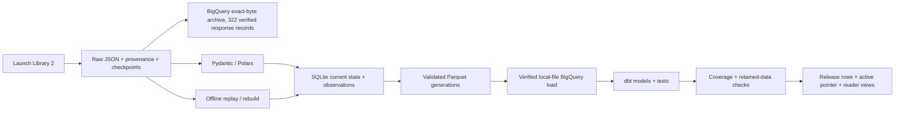

# Space Launch Atlas — The Industrialization of Space

**How is access to orbit changing — who launches, how reliably, and with how much reuse?**

An interactive visualization project using public worldwide launch data, with **Data Studio (formerly Looker Studio)** for reporting and **Terraform** for cloud infrastructure definitions.

**Release 1** covers launch activity, providers/vehicles, reliability, spaceports, reuse and upcoming launches. **Release 2** adds detailed satellite and spacecraft views with reviewed payload/source coverage.

## What works today

A local Python CLI saves replayable LL2 responses, maintains SQLite current state and observations, and exports validated Parquet. The initial 1957–2026 history backfill and raw replay audit are complete. As of 2026-11-14, accepted local state is revision 220: 7,686 launches, 7,739 observation events, 16,151 sightings and zero conflicts. On 2026-11-15, the worker checkpoint was reconciled to revision 220 and set for its next action on 2026-11-21 11:15 UTC; both local Windows scheduled tasks remain disabled.

A manual end-to-end refresh on 2026-11-14 made seven LL2 requests, all HTTP 200, and committed the recent, upcoming and correction windows. The exact seven BigQuery raw-response bodies matched their local SHA-256 checksums. The local Dagster chain loaded the updated typed sources and built 31 candidate tables/views in BigQuery scratch; dbt passed 108 tests and all 15 reporting relations passed candidate validation. The run artifacts record 1,803,550,720 billed bytes across 139 dbt jobs and 32 warehouse validation queries. It was not published: active production release `sla-release-v1-d4f4ae640e0934f11d7ad4c4` remains on its 2026-11-11 snapshot, and the private Data Studio report remains on that active release.

The previous production release built 20 table models, 11 views and 108 tests; nine analytical marts cover launch outcomes, flown hardware, reuse and landings, supported turnaround, site cadence, schedule movement, upcoming launches and coverage. The protected BigQuery raw-response table now contains 322 rows: 304 historical local responses, 11 from two Cloud Run executions and seven from the manual refresh. See [ROADMAP.md](ROADMAP.md) for dated evidence and next actions.

The [Step 4 restart proof](ROADMAP.md#hosted-worker-and-raw-response-archive-work-started-2026-11-11) restored the production checkpoint from BigQuery scratch and verified that a replacement worker can resume committed progress without repeating a completed LL2 page. Two Cloud Run executions wrote 11 response bodies directly to the permanent BigQuery raw table; their hashes matched. The first paused after a `502` with `Retry-After: 60`. The second exceeded its requested one-call cap because the deployed `tick_worker` overrode it; the local fix is tested but not deployed. Do not run that image again until it is redeployed. The local Windows task registrations are disabled, and no Cloud Scheduler or durable hosted state exists. Before the 2026-11-14 test, the project preflight observed 31,729,909,760 billed query bytes and 608,837,658 stored bytes; the account has no other BigQuery project. Recorded query processing remained within the 1 TiB monthly allowance; total stored bytes were not remeasured after the candidate tables were created. Future Data Studio traffic and Cloud Run egress still need monitoring.



Terraform CLI 1.13.1 and locked Google provider 7.46.2 manage six datasets, required APIs, four scoped workload identities, the raw-response table, a private image repository and one Cloud Run Job. Two executions verified 11 direct BigQuery response writes, but the second exceeded the requested one-call limit due to a code defect. The local fix is tested but not deployed; do not run the current image again. There is no Cloud Scheduler or durable cloud checkpoint. Terraform state and local raw/state recovery copies stay on disk; persistent GCS is not selected. Local gcloud ADC supplies local BigQuery access; Cloud Run uses its attached keyless service identity. The current source tables consumed by dbt continue to be loaded from normalized Parquet; the separate raw archive does not replace that load. The integrated runner caps each query at 100 MB; the standalone dbt profile defaults to a configurable 1 GB cap. These are per-job limits, not a monthly spending guarantee. The public source repository is [RM3006/orbital-pulse](https://github.com/RM3006/orbital-pulse); CI checks Linux and Windows without cloud credentials. See [operations](docs/operations.md), [architecture](ARCHITECTURE.md) and [roadmap](ROADMAP.md).

## Quick start

Use Python 3.12 and uv from the repository root:

```powershell
uv sync --locked
uv run python -m launch_atlas doctor --offline
uv run python -m launch_atlas import-raw --input tests/fixtures/ll2_history_1957.json --observed-at 2026-11-01T17:04:49.556708+00:00 --orbital-only --run-id demo-1957
uv run python -m launch_atlas replay --run-id demo-1957
```

This recreates the saved three-launch 1957 slice offline. For an existing demo ID, use replay directly. Full setup/check commands, configuration, live budgets, resume and recovery are in [operations](docs/operations.md). Default tests do not call public APIs or cloud services.

## Documentation

| File | Purpose |
|---|---|
| [PROJECT_BRIEF.md](PROJECT_BRIEF.md) | Product intent, release scope and constraints. |
| [ARCHITECTURE.md](ARCHITECTURE.md) | Explicit tech stack, responsibilities and implemented/target design. |
| [ROADMAP.md](ROADMAP.md) | Single plan for all steps, progress, checks and next work. |
| [AGENTS.md](AGENTS.md) | Coding-agent instructions and project boundaries. |
| [docs/data_sources.md](docs/data_sources.md) | Source provenance, missingness, terms and table grains. |
| [docs/metrics.md](docs/metrics.md) | Metric formulas, denominators, time basis and exclusions. |
| [docs/operations.md](docs/operations.md) | Setup, execution, quotas, replay/rebuild and recovery. |
| [docs/decisions.md](docs/decisions.md) | Recorded choices and reasons. |
| [infra/README.md](infra/README.md) | Terraform files, checks and deployment prerequisites. |
| [tests/fixtures/README.md](tests/fixtures/README.md) | Test-data provenance and limitations. |

Keep delivery plans in `ROADMAP.md`; use the existing documents for their stated purpose. Dated verification summaries remain in `docs/*verification.json`; raw data/state and generated artifacts are ignored. The technical harness is `pyproject.toml`, `uv.lock`, `.python-version`, `.env.example`, the Python tests, `.github/workflows/ci.yml` and the Terraform configuration/lock/mock tests under `infra/terraform/`.

Code: MIT. Source data: [The Space Devs](https://thespacedevs.com/llapi), subject to its own [terms](https://github.com/TheSpaceDevs/Tutorials/blob/main/faqs/faq_TSD.md#terms-of-use). Images are not downloaded or displayed. The project is independent of launch operators.
