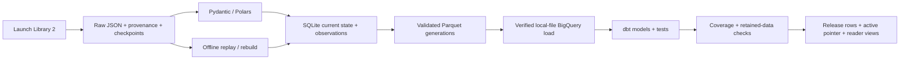

# Space Launch Atlas — The Industrialization of Space

**How is access to orbit changing — who launches, how reliably, and with how much reuse?**

An interactive visualization project using public worldwide launch data, with **Data Studio (formerly Looker Studio)** for reporting and **Terraform** for cloud infrastructure definitions.

**Release 1** covers launch activity, providers/vehicles, reliability, spaceports, reuse and upcoming launches. **Release 2** adds detailed satellite and spacecraft views with reviewed payload/source coverage.

## What works today

A local Python CLI saves replayable LL2 responses, resumes queries, maintains SQLite current state/observations and exports validated Parquet. One Dagster job now pins inputs, loads local Parquet into BigQuery, builds/tests dbt models, validates reporting data, and optionally retains/activates a release. Revision 42 is loaded: 31 models, 102 data tests and 6 unit tests passed in scratch. Nine analytical marts cover launch/family outcomes, flown hardware, deduplicated reuse/landings, supported turnaround, site cadence, schedule movement, upcoming schedules and coverage. Reporting storage retains rows and dimensions separately from mutable candidates, with consistent views and atomic activation/rollback. The full history remains incomplete, so the production candidate is ineligible for activation. Current verification is in [ROADMAP.md](ROADMAP.md). A local Windows worker resumes LL2 history automatically, then performs weekly recent/upcoming/correction refreshes and validated exports. No Data Studio report or automatic BigQuery build is operating.



Terraform CLI 1.13.1 and locked Google provider 7.46.2 manage six datasets, four APIs and two scoped workload identities in the existing project. Terraform state and raw files stay local; GCS is deferred. Local gcloud ADC supplies the authorized BigQuery workflow. The integrated runner caps each query at 100 MB; the standalone dbt profile defaults to a configurable 1 GB cap. These are per-job limits, not a monthly spending guarantee. The public source repository is [RM3006/orbital-pulse](https://github.com/RM3006/orbital-pulse); CI checks Linux and Windows without cloud credentials. See [operations](docs/operations.md), [architecture](ARCHITECTURE.md) and [roadmap](ROADMAP.md).

## Quick start

Use Python 3.12 and uv from the repository root:

```powershell
uv sync --locked
uv run python -m launch_atlas doctor --offline
uv run python -m launch_atlas import-raw --input tests/fixtures/ll2_history_1957.json --observed-at 2026-11-01T17:04:49.556708+00:00 --orbital-only --run-id demo-1957
uv run python -m launch_atlas replay --run-id demo-1957
```

This recreates the saved three-launch 1957 slice offline. For an existing demo ID, use replay directly. Full setup/check commands, configuration, live budgets, resume and recovery are in [operations](docs/operations.md). Default tests do not call public APIs or cloud services.

## Documentation

| File | Purpose |
|---|---|
| [PROJECT_BRIEF.md](PROJECT_BRIEF.md) | Product intent, release scope and constraints. |
| [ARCHITECTURE.md](ARCHITECTURE.md) | Explicit tech stack, responsibilities and implemented/target design. |
| [ROADMAP.md](ROADMAP.md) | Single plan for all steps, progress, checks and next work. |
| [AGENTS.md](AGENTS.md) | Coding-agent instructions and project boundaries. |
| [docs/data_sources.md](docs/data_sources.md) | Source provenance, missingness, terms and table grains. |
| [docs/metrics.md](docs/metrics.md) | Metric formulas, denominators, time basis and exclusions. |
| [docs/operations.md](docs/operations.md) | Setup, execution, quotas, replay/rebuild and recovery. |
| [docs/decisions.md](docs/decisions.md) | Recorded choices and reasons. |
| [infra/README.md](infra/README.md) | Terraform files, checks and deployment prerequisites. |
| [tests/fixtures/README.md](tests/fixtures/README.md) | Test-data provenance and limitations. |

Keep delivery plans in `ROADMAP.md`; use the existing documents for their stated purpose. Dated verification summaries remain in `docs/*verification.json`; raw data/state and generated artifacts are ignored. The technical harness is `pyproject.toml`, `uv.lock`, `.python-version`, `.env.example`, the Python tests, `.github/workflows/ci.yml` and the Terraform configuration/lock/mock tests under `infra/terraform/`.

Code: MIT. Source data: [The Space Devs](https://thespacedevs.com/llapi), subject to its own [terms](https://github.com/TheSpaceDevs/Tutorials/blob/main/faqs/faq_TSD.md#terms-of-use). Images are not downloaded or displayed. The project is independent of launch operators.
