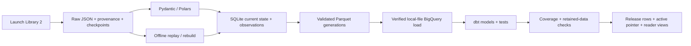

# Space Launch Atlas — The Industrialization of Space

**How is access to orbit changing — who launches, how reliably, and with how much reuse?**

An interactive visualization project using public worldwide launch data, with **Data Studio (formerly Looker Studio)** for reporting and **Terraform** for cloud infrastructure definitions.

**Release 1** covers launch activity, providers/vehicles, reliability, spaceports, reuse and upcoming launches. **Release 2** adds detailed satellite and spacecraft views with reviewed payload/source coverage.

## What works today

A local Python CLI saves replayable LL2 responses, maintains SQLite current state and observations, and exports validated Parquet. The initial 1957–2026 history backfill and raw replay audit are complete. The resumed worker advanced state to revision 217 on 2026-11-11: 7,683 launches, 7,718 observations, 15,861 sightings and zero conflicts. The local Dagster chain loads a pinned snapshot into BigQuery, builds/tests dbt models, validates reporting data and activates a release. Current production release `sla-release-v1-d4f4ae640e0934f11d7ad4c4` was published from snapshot `sla-input-v1-36d5e54dfe66915cc6747fa6ad17f1ad1d3726b57b1cc8d4d664627d7e3e271b`; 31 models and 108 tests passed, and 94 query jobs billed 681,574,400 bytes. Nine analytical marts cover launch outcomes, flown hardware, reuse and landings, supported turnaround, site cadence, schedule movement, upcoming launches and coverage. A local Windows task checks for changed snapshots daily. Scheduled publication now skips until `.env.local` explicitly confirms `BIGQUERY_FREE_TIER_SCOPE=single-project-confirmed`; Google applies its free query and storage allowances per billing account, while the automated usage check is project-scoped. The private five-page Data Studio report now uses six functional production sources; its refreshed coverage table shows the current release. The report remains private and has no scheduled refresh. See [ROADMAP.md](ROADMAP.md) for evidence and current decisions.



Terraform CLI 1.13.1 and locked Google provider 7.46.2 manage six datasets, four APIs and two scoped workload identities in the existing project. Terraform state and raw files stay local; GCS is deferred. Local gcloud ADC supplies the authorized BigQuery workflow. The integrated runner caps each query at 100 MB; the standalone dbt profile defaults to a configurable 1 GB cap. These are per-job limits, not a monthly spending guarantee. The public source repository is [RM3006/orbital-pulse](https://github.com/RM3006/orbital-pulse); CI checks Linux and Windows without cloud credentials. See [operations](docs/operations.md), [architecture](ARCHITECTURE.md) and [roadmap](ROADMAP.md).

## Quick start

Use Python 3.12 and uv from the repository root:

```powershell
uv sync --locked
uv run python -m launch_atlas doctor --offline
uv run python -m launch_atlas import-raw --input tests/fixtures/ll2_history_1957.json --observed-at 2026-11-01T17:04:49.556708+00:00 --orbital-only --run-id demo-1957
uv run python -m launch_atlas replay --run-id demo-1957
```

This recreates the saved three-launch 1957 slice offline. For an existing demo ID, use replay directly. Full setup/check commands, configuration, live budgets, resume and recovery are in [operations](docs/operations.md). Default tests do not call public APIs or cloud services.

## Documentation

| File | Purpose |
|---|---|
| [PROJECT_BRIEF.md](PROJECT_BRIEF.md) | Product intent, release scope and constraints. |
| [ARCHITECTURE.md](ARCHITECTURE.md) | Explicit tech stack, responsibilities and implemented/target design. |
| [ROADMAP.md](ROADMAP.md) | Single plan for all steps, progress, checks and next work. |
| [AGENTS.md](AGENTS.md) | Coding-agent instructions and project boundaries. |
| [docs/data_sources.md](docs/data_sources.md) | Source provenance, missingness, terms and table grains. |
| [docs/metrics.md](docs/metrics.md) | Metric formulas, denominators, time basis and exclusions. |
| [docs/operations.md](docs/operations.md) | Setup, execution, quotas, replay/rebuild and recovery. |
| [docs/decisions.md](docs/decisions.md) | Recorded choices and reasons. |
| [infra/README.md](infra/README.md) | Terraform files, checks and deployment prerequisites. |
| [tests/fixtures/README.md](tests/fixtures/README.md) | Test-data provenance and limitations. |

Keep delivery plans in `ROADMAP.md`; use the existing documents for their stated purpose. Dated verification summaries remain in `docs/*verification.json`; raw data/state and generated artifacts are ignored. The technical harness is `pyproject.toml`, `uv.lock`, `.python-version`, `.env.example`, the Python tests, `.github/workflows/ci.yml` and the Terraform configuration/lock/mock tests under `infra/terraform/`.

Code: MIT. Source data: [The Space Devs](https://thespacedevs.com/llapi), subject to its own [terms](https://github.com/TheSpaceDevs/Tutorials/blob/main/faqs/faq_TSD.md#terms-of-use). Images are not downloaded or displayed. The project is independent of launch operators.
