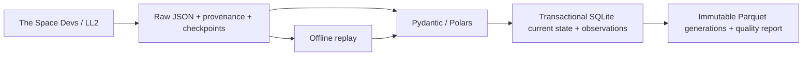

# Space Launch Atlas — The Industrialization of Space

**How is access to orbit changing — who launches, how reliably, and with how much reuse?**

Phases 0–2 have a working local implementation: a Python CLI ingests public Launch Library 2 data into immutable raw JSON, resumes saved checkpoints, maintains cross-run current state and meaningful observation history in SQLite, and exports validated Parquet generations offline. It separates launch attempts from upcoming schedules, hardware flights, source precision and missingness. Historical acquisition is partial; no website, warehouse, automated schedule or public reporting release is running.



Live Phase 2 verification on **7 November 2026** completed a 3-window refresh in 7 requests: 22 recent, 250 upcoming and 37 correction-query records (overlapping counts are not additive). The current state has 287 distinct launch IDs and 308 semantic observation events; 179 upcoming schedule intervals overlap the frozen 90-day horizon, while 33 unsupported-precision candidates are visible in coverage and excluded from that interval fact. A two-pass 1957 slice reconciled in 2 requests. The full 1957–2026 backfill has 138 of 140 initial annual windows still pending; this is not a completeness or worldwide reliability claim. [Evidence and method](docs/phase2_verification.json).

Install and check:

```powershell
uv sync --locked
uv run ruff check .
uv run ruff format --check .
uv run pyright
uv run pytest -m "not integration and not live" --basetemp .pytest-tmp
uv run python -m launch_atlas doctor --offline
```

Reproduce the genuine 1957 raw-to-Parquet slice offline:

```powershell
uv run python -m launch_atlas import-raw --input tests/fixtures/ll2_history_1957.json --observed-at 2026-11-01T17:04:49.556708+00:00 --orbital-only --run-id demo-1957
uv run python -m launch_atlas replay --run-id demo-1957
```

Output: `data/raw/ll2/demo-1957/` and `data/normalized/demo-1957/` (ten Parquet tables plus quality.json). For an existing demo ID, run replay directly. `uv run python -m launch_atlas --help` lists only implemented commands. An explicit live smoke command is `uv run python -m launch_atlas smoke --source ll2 --max-requests 2`; default tests never call the source. See [setup](SETUP.md) for Windows/Linux commands, request budgets, safe resume, environment variables and exit codes.

Current verification is recorded in the [handoff](docs/handoff.md). The offline suite includes substantive state, observation, precision, window, export/rebuild and acquisition tests. Ruff, Pyright, locked install and wheel packaging are part of the local checks. CI targets Windows/Linux but has not run on GitHub.

Next local work is to continue the metered historical backfill from 1958 and reconcile completed passes. Proposed production remains **GCS + BigQuery + dbt**, **Dagster invoked by scheduled GitHub Actions**, and **Google Data Studio**, subject to account, spend and reporting-product decisions. Those services/adapters are not installed or provisioned. [Architecture](ARCHITECTURE.md), [decisions](docs/decisions.md), [metrics](docs/metrics.md), [operations](docs/operations.md), and [roadmap](ROADMAP.md) distinguish implementation from plans.

Code: MIT. Source data: [The Space Devs](https://thespacedevs.com/llapi), subject to its own [terms](https://github.com/TheSpaceDevs/Tutorials/blob/main/faqs/faq_TSD.md#terms-of-use). Images are not downloaded or displayed. The project is independent of launch operators and is not a live control or telemetry service.
