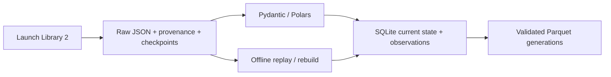

# Space Launch Atlas — The Industrialization of Space

**How is access to orbit changing — who launches, how reliably, and with how much reuse?**

An interactive visualization project using public worldwide launch data, with **Data Studio (formerly Looker Studio)** for reporting and **Terraform** for cloud infrastructure definitions.

**Release 1** covers launch activity, providers/vehicles, reliability, spaceports, reuse and upcoming launches. **Release 2** adds detailed satellite and spacecraft views with reviewed payload/source coverage.

## What works today

A local Python CLI ingests LL2 responses into immutable local raw files, resumes saved queries, maintains cross-run SQLite state/observations and exports validated Parquet generations. Step 3 pins a verified snapshot, loads local Parquet directly into BigQuery with deterministic jobs/receipts, and builds/tests dbt models in expiring scratch. The warehouse currently holds revision 27: all 11 source tables loaded and cloud row counts matched the receipt; all 26 dbt models, 80 warehouse data tests and a synthetic outcome-denominator unit test passed. The BigQuery release-metadata backend passed synthetic publish/CAS/rollback checks in scratch; retained reporting data, reader views and full orchestration remain unfinished. Local history has since advanced to revision 42, but remains incomplete and has not been reloaded to BigQuery. No release was published and the reporting dataset remains empty. GCS is deferred; Data Studio is not connected; no schedule or public dashboard is running.



Terraform CLI 1.13.1 and locked Google provider 7.46.2 are applied to the existing project: six datasets, four APIs, two workload service accounts and least-privilege dataset/job roles. The local Terraform state is not remote. The user authorized BigQuery processing within the active Free Trial's monthly free limits. GCS is excluded and raw files stay local. Local gcloud ADC and `dbt debug` pass; ADC uses the user-approved `cloud-platform` OAuth scope only (no Cloud SQL), while the private dbt profile declares BigQuery and caps each query at 1 GB. Data Studio is selected but not connected; no report or website is published. See the local ADC instructions in [operations](docs/operations.md#local-dbt-authentication-with-google-cloud-cli-adc), [architecture](ARCHITECTURE.md) and [roadmap](ROADMAP.md).

## Quick start

Use Python 3.12 and uv from the repository root:

```powershell
uv sync --locked
uv run python -m launch_atlas doctor --offline
uv run python -m launch_atlas import-raw --input tests/fixtures/ll2_history_1957.json --observed-at 2026-11-01T17:04:49.556708+00:00 --orbital-only --run-id demo-1957
uv run python -m launch_atlas replay --run-id demo-1957
```

This recreates the saved three-launch 1957 slice offline. For an existing demo ID, use replay directly. Full setup/check commands, configuration, live budgets, resume and recovery are in [operations](docs/operations.md). Default tests do not call public APIs or cloud services.

## Documentation

| File | Purpose |
|---|---|
| [PROJECT_BRIEF.md](PROJECT_BRIEF.md) | Product intent, release scope and constraints. |
| [ARCHITECTURE.md](ARCHITECTURE.md) | Explicit tech stack, responsibilities and implemented/target design. |
| [ROADMAP.md](ROADMAP.md) | Single plan for all steps, progress, checks and next work. |
| [AGENTS.md](AGENTS.md) | Coding-agent instructions and project boundaries. |
| [docs/data_sources.md](docs/data_sources.md) | Source provenance, missingness, terms and table grains. |
| [docs/metrics.md](docs/metrics.md) | Metric formulas, denominators, time basis and exclusions. |
| [docs/operations.md](docs/operations.md) | Setup, execution, quotas, replay/rebuild and recovery. |
| [docs/decisions.md](docs/decisions.md) | Recorded choices and reasons. |
| [infra/README.md](infra/README.md) | Terraform files, checks and deployment prerequisites. |
| [tests/fixtures/README.md](tests/fixtures/README.md) | Test-data provenance and limitations. |

Keep delivery plans in `ROADMAP.md`; use the existing documents for their stated purpose. Dated verification summaries remain in `docs/*verification.json`; raw data/state and generated artifacts are ignored. The technical harness is `pyproject.toml`, `uv.lock`, `.python-version`, `.env.example`, the Python tests, `.github/workflows/ci.yml` and the Terraform configuration/lock/mock tests under `infra/terraform/`.

Code: MIT. Source data: [The Space Devs](https://thespacedevs.com/llapi), subject to its own [terms](https://github.com/TheSpaceDevs/Tutorials/blob/main/faqs/faq_TSD.md#terms-of-use). Images are not downloaded or displayed. The project is independent of launch operators.
